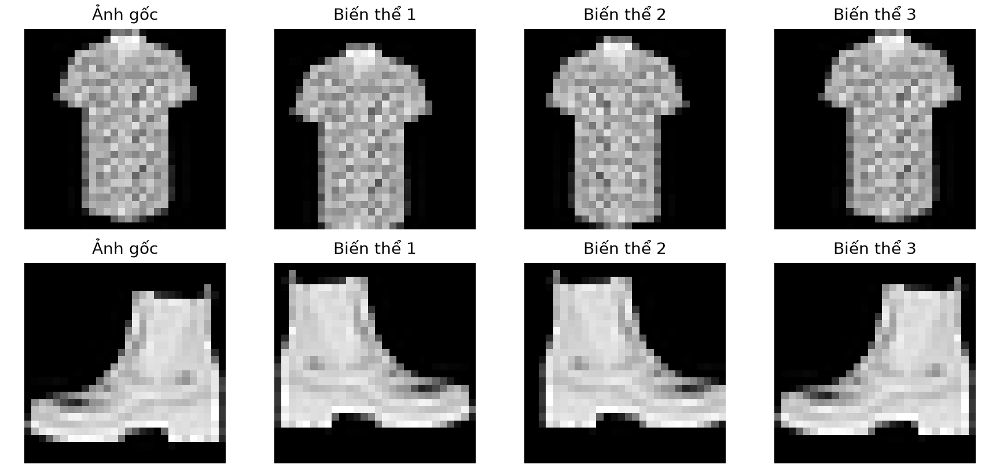
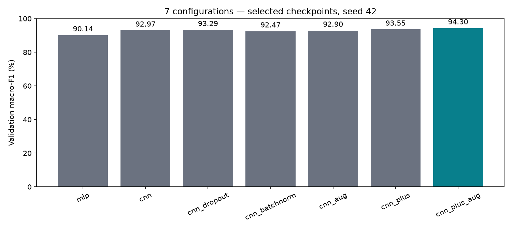
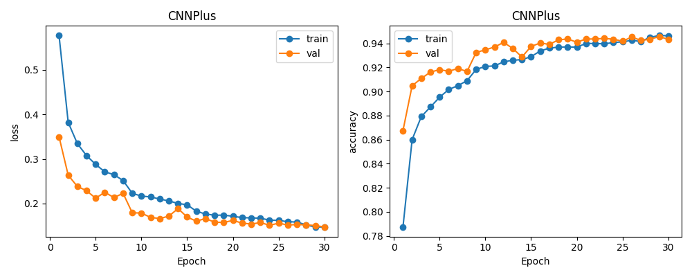
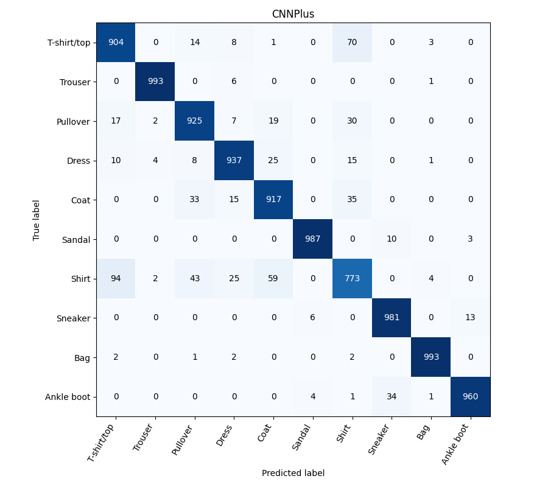
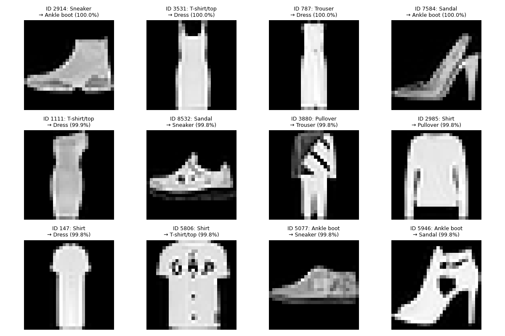
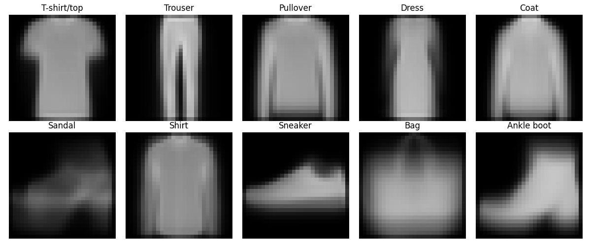
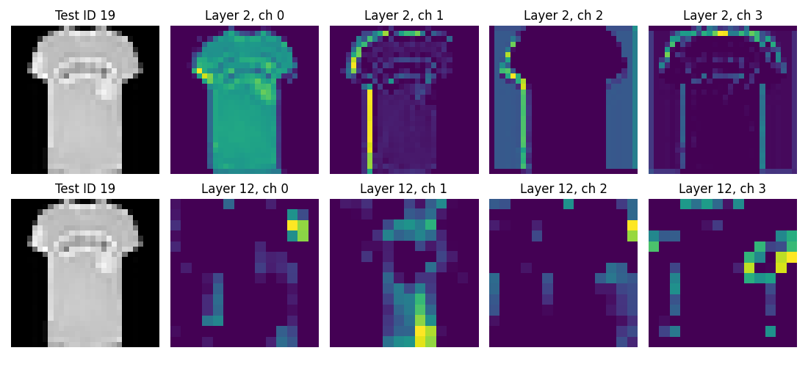
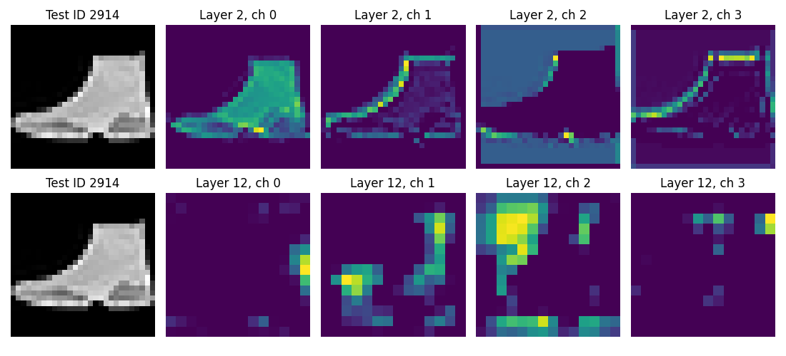
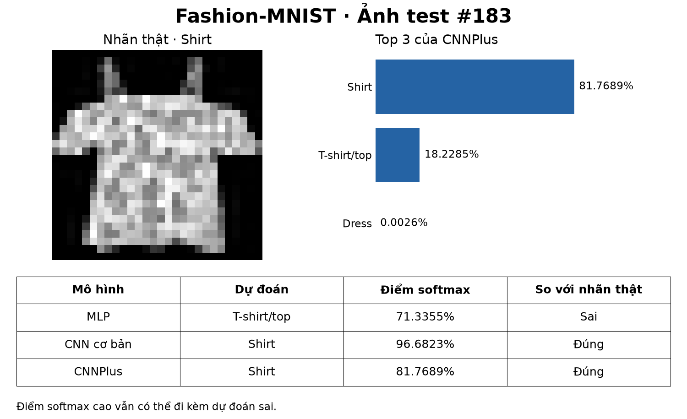

# Phân loại ảnh thời trang bằng CNN

ĐẠI HỌC CÔNG NGHIỆP HÀ NỘI

KHOA CÔNG NGHỆ THÔNG TIN VÀ TRUYỀN THÔNG

Học phần: Trí tuệ nhân tạo

Giảng viên: Dương Hiền Thanh

Ngày hoàn thiện: 08/11/2026

| Mã sinh viên | Họ và tên |
| --- | --- |
| 2024601724 | Trương Văn Hùng |
| 2024601547 | Nguyễn Trọng Thái |
| 2024611308 | Lò Thanh Tùng |
| 2024602074 | Nguyễn Hữu Sáng |
| 2024602812 | Ngô Khánh Hưng |

## LỜI MỞ ĐẦU

Phân loại ảnh là một bài toán cơ bản của thị giác máy tính, trong đó mô hình học cách gán nhãn từ các ví dụ đã biết. Trong học phần Trí tuệ nhân tạo, nhóm thực hiện đề tài “Phân loại ảnh thời trang bằng CNN” để tìm hiểu trọn vẹn quá trình xử lý dữ liệu, xây dựng mạng nơ-ron, huấn luyện, đánh giá và suy luận trên một ảnh mới.

Nghiên cứu sử dụng Fashion-MNIST với 70.000 ảnh xám thuộc 10 lớp. Nhóm xây dựng MLP làm mô hình đối chứng, CNN cơ bản và các biến thể có Dropout, Batch Normalization, augmentation. Bảy cấu hình được so sánh theo cùng giao thức validation; cấu hình được chọn được kiểm tra thêm ở hai seed. Checkpoint CNNPlus dùng cho demo đạt accuracy 93,70% trên 10.000 ảnh test. Phép kiểm chứng lại với trọng số cố định ngày 08/11/2026 cho kết quả nhãn trùng khớp với lần đánh giá trên Colab.

Báo cáo gồm sáu chương: giới thiệu đề tài; cơ sở lý thuyết; phân tích và xử lý dữ liệu; xây dựng và huấn luyện hệ thống; thực nghiệm và đánh giá; kết luận và hướng phát triển. Nội dung tập trung vào mối liên hệ giữa lựa chọn kỹ thuật, kết quả đo và giới hạn diễn giải. Phân tích ảnh đúng, ảnh sai và đặc trưng học được giúp minh họa rằng accuracy cao hoặc điểm dự đoán cao chưa bảo đảm mọi ảnh đều được nhận diện chính xác.

Nhóm xin cảm ơn giảng viên Dương Hiền Thanh đã hướng dẫn trong quá trình học tập và thực hiện đề tài. Những hạn chế về khả năng khái quát ngoài Fashion-MNIST, số lần lặp thực nghiệm và giải thích quyết định của mô hình được trình bày cùng kết quả để làm cơ sở cho các nghiên cứu tiếp theo.

## MỤC LỤC

## DANH MỤC HÌNH ẢNH

## DANH MỤC BẢNG BIỂU

# CHƯƠNG 1. GIỚI THIỆU ĐỀ TÀI

## 1.1 Bài toán và phạm vi

Phân loại ảnh là việc gán một nhãn cho ảnh dựa trên nội dung. Trong đề tài này, đầu vào là một ảnh thời trang xám 28×28 pixel; đầu ra là một trong 10 lớp của Fashion-MNIST. Hệ thống tính điểm cho từng lớp rồi chọn lớp có điểm lớn nhất. Nhãn thật chỉ dùng khi huấn luyện hoặc đánh giá; lúc dự đoán một ảnh mới, mô hình không được nhận sẵn đáp án.

Đề tài thuộc học sâu có giám sát: dữ liệu gồm ảnh và nhãn, còn trọng số của mạng được học từ dữ liệu. Phạm vi triển khai là ảnh Fashion-MNIST đã chuẩn hóa về kích thước và cách biểu diễn. Hệ thống minh họa quá trình phân loại, không phải công cụ nhận diện mọi sản phẩm trong ảnh có người mặc, nền phức tạp hoặc nhiều vật thể.

## 1.2 Mục tiêu thực hiện

Nhóm đặt ra ba mục tiêu: xây dựng quy trình dữ liệu và huấn luyện có thể kiểm tra lại; so sánh MLP với CNN cùng các biến thể; trình bày được vì sao mô hình dự đoán đúng hoặc sai trong giới hạn bằng chứng. Chất lượng được đo bằng accuracy, macro-F1, chỉ số từng lớp và ma trận nhầm lẫn, thay vì chỉ chọn một ảnh demo đẹp.

Một mục tiêu trọng tâm là phân biệt tiền xử lý ảnh với đặc trưng CNN tự học. Vì vậy, nhóm phân tích ảnh trung bình theo lớp, đối chiếu các lớp dễ nhầm và trực quan hóa kích hoạt ở hai tầng trên ảnh đúng và ảnh sai. Các hình này hỗ trợ quan sát hành vi mạng, không được xem là lời giải thích nhân quả đầy đủ.

## 1.3 Cách tiếp cận

| Bước | Công việc | Đầu ra |
| --- | --- | --- |
| Dữ liệu | Chia tập, thống kê train, chuẩn hóa | Split và preprocessing được lưu |
| Mô hình | MLP, CNN và các biến thể | Kiến trúc và số tham số |
| Huấn luyện | Adam, validation, checkpoint, dừng sớm | Trọng số và lịch sử từng epoch |
| Đánh giá | Chốt cấu hình rồi đo test | Bảng chỉ số, ảnh sai, feature maps |
| Demo | Nạp checkpoint, suy luận ảnh | Top 3 và so sánh ba mô hình |

*Bảng 1.1 Các bước thực hiện hệ thống*

## 1.4 Đóng góp của sản phẩm

Sản phẩm gồm mã nguồn theo chức năng, notebook điều phối Colab, kết quả của bảy cấu hình, kiểm tra độ dao động qua ba seed và demo offline. Đóng góp chính là quy trình thực nghiệm có thể truy nguồn, các đối chứng kỹ thuật và phân tích lỗi có bằng chứng. Mỗi cải tiến được xem xét theo kết quả đo thay vì mặc định làm tăng chất lượng.

# CHƯƠNG 2. CƠ SỞ LÝ THUYẾT

## 2.1 Ảnh đầu vào và trọng số

Pixel là giá trị mô tả độ sáng của ảnh. Trọng số là các số nằm bên trong mô hình, quyết định cách kết hợp dữ liệu đầu vào. Hai khái niệm có vai trò khác nhau: ảnh thay đổi theo từng mẫu, còn cùng một bộ trọng số được dùng cho nhiều ảnh. Khi huấn luyện, bộ tối ưu thay đổi trọng số để giảm sai lệch dự đoán; khi demo, trọng số được giữ cố định.

## 2.2 MLP và CNN xử lý cùng một ảnh

MLP trong dự án trải ảnh 28×28 thành vector 784 giá trị rồi đưa qua hai lớp Linear. Flatten chỉ đổi cách sắp xếp; giá trị pixel vẫn được giữ. Kiến trúc này không áp đặt quan hệ lân cận và bộ lọc dùng chung như CNN. CNN làm việc trên các vùng ảnh nhỏ, áp dụng cùng một bộ lọc ở nhiều vị trí rồi kết hợp thông tin qua nhiều tầng. [2]

| Thành phần | Vai trò trong dự án |
| --- | --- |
| Conv2d | Học bộ lọc 3×3 để tạo các bản đồ kích hoạt. |
| ReLU | Giữ phần dương và đưa phần âm về 0; thêm tính phi tuyến. |
| MaxPool2d | Lấy giá trị lớn nhất trong từng vùng 2×2, giảm kích thước ảnh đặc trưng. |
| Flatten | Đổi khối đặc trưng thành vector để đưa vào lớp Linear. |
| Linear | Tổng hợp thông tin và tạo 10 điểm đầu ra gọi là logits. |

*Bảng 2.1 Vai trò của các lớp trong mạng CNN*

Ở CNN cơ bản, Conv đầu nhận một kênh ảnh và tạo 16 kênh. Kernel 3×3, padding 1 và stride 1 giữ kích thước 28×28. Max pooling 2×2 giảm còn 14×14. Đây là cách các tham số trong code liên hệ trực tiếp với kích thước tensor. [3]

## 2.3 Ví dụ về bộ lọc và số tham số

Một bộ lọc 3×3 trên ảnh một kênh có 9 trọng số. Khi có 16 bộ lọc và mỗi bộ lọc có một bias, lớp Conv đầu của CNN cơ bản có 16×(9+1)=160 tham số. Bộ lọc di chuyển khắp ảnh nhưng không tạo bộ trọng số mới tại từng vị trí. Sau huấn luyện, từng bộ lọc có thể phản ứng khác nhau với các mẫu cục bộ.

Số tham số phụ thuộc kiến trúc cụ thể. Trong dự án, MLP có 101.770 tham số, CNN cơ bản có 206.922 và CNNPlus có 468.010. Do đó, không thể kết luận CNN luôn ít tham số hơn MLP. Phần thực nghiệm sẽ xem đồng thời chất lượng và độ lớn mô hình.

## 2.4 Quá trình học từ logits đến cập nhật trọng số

Mỗi batch là một nhóm ảnh được xử lý cùng lúc; với batch size 128, đầu ra có dạng 128×10 logits. Một epoch là một lượt đi qua toàn bộ tập train. Logits là điểm thô, không phải pixel và chưa phải xác suất. CrossEntropyLoss nhận trực tiếp logits cùng nhãn nguyên từ 0 đến 9; không gọi softmax trước hàm loss này. [4]

Về ý nghĩa, loss lớn khi mô hình gán xác suất thấp cho nhãn đúng. Gradient đo độ nhạy của loss theo từng trọng số. Backpropagation tính các gradient đó bằng quy tắc dây chuyền. Adam dùng trung bình động của gradient và bình phương gradient để điều chỉnh bước cập nhật; learning rate ban đầu của dự án là 0,001. [5]

```python
optimizer.zero_grad(set_to_none=True)
logits = model(images)
loss = criterion(logits, labels)
loss.backward()
optimizer.step()
```

Năm dòng trên lần lượt xóa gradient cũ, tính điểm, tính loss, tính gradient mới và cập nhật trọng số. Xóa gradient không phải xóa trọng số. Validation chuyển mô hình sang eval(), tắt ghi gradient và chỉ chạy forward, tính loss; không gọi zero_grad(), backward() hoặc step().

## 2.5 Các kỹ thuật được khảo sát

| Kỹ thuật | Cơ chế và cách dùng |
| --- | --- |
| Batch Normalization | Chuẩn hóa kích hoạt theo batch khi train; khi eval dùng thống kê đã tích lũy. CNNPlus đặt BN sau các lớp Conv. [6] |
| Dropout | Ngẫu nhiên bỏ một phần kích hoạt khi train; tắt cơ chế này khi eval. Dự án dùng p=0,3 ở phần phân loại. [7] |
| Augmentation | Tạo biến thể ảnh train bằng crop và lật ngang, giữ nhãn. Validation/test không dùng biến đổi ngẫu nhiên. |
| Scheduler | ReduceLROnPlateau theo dõi validation loss và giảm learning rate khi tiến bộ chững lại. |
| Early stopping | Dừng nếu validation loss không cải thiện đủ qua số epoch quy định. Dừng sớm khác với chọn checkpoint tốt nhất. |

*Bảng 2.2 Các kỹ thuật được khảo sát*

## 2.6 Chỉ số đánh giá

Accuracy là tỷ lệ dự đoán đúng. Precision của một lớp đo phần dự đoán thuộc lớp đó thực sự đúng; recall đo phần mẫu thật của lớp đó được tìm đúng. F1 kết hợp precision và recall; macro-F1 lấy trung bình F1 của 10 lớp với trọng số bằng nhau. Vì thế cần xem từng lớp ngay cả khi accuracy chung cao. Ma trận nhầm lẫn dùng hàng là nhãn thật và cột là nhãn dự đoán.

# CHƯƠNG 3. PHÂN TÍCH VÀ XỬ LÝ DỮ LIỆU

## 3.1 Fashion-MNIST và ánh xạ nhãn

Fashion-MNIST do Zalando Research công bố, gồm 60.000 ảnh ở tập train gốc và 10.000 ảnh test. Mỗi ảnh xám có kích thước 28×28 và một nhãn thuộc 10 lớp. Nhóm đọc dữ liệu bằng torchvision.datasets.FashionMNIST. Tổng dữ liệu là 70.000 ảnh. [1]

| Nhãn | Tên lớp gốc | Diễn giải tiếng Việt |
| --- | --- | --- |
| 0 | T-shirt/top | Áo thun hoặc áo phần thân trên |
| 1 | Trouser | Quần dài |
| 2 | Pullover | Áo chui đầu |
| 3 | Dress | Váy liền |
| 4 | Coat | Áo khoác |
| 5 | Sandal | Dép xăng đan |
| 6 | Shirt | Áo sơ mi |
| 7 | Sneaker | Giày thể thao |
| 8 | Bag | Túi |
| 9 | Ankle boot | Bốt cổ ngắn |

*Bảng 3.1 Ánh xạ mười lớp Fashion-MNIST*

## 3.2 Chia tập và kiểm soát rò rỉ dữ liệu

| Tập | Số ảnh | Mỗi lớp | Vai trò |
| --- | --- | --- | --- |
| Train | 54.000 | 5.400 | Cập nhật trọng số và tính mean/std |
| Validation | 6.000 | 600 | Theo dõi học và lựa chọn mô hình |
| Test | 10.000 | 1.000 | Đánh giá checkpoint đã chốt |

*Bảng 3.2 Phân chia dữ liệu và vai trò từng tập*

Từ 60.000 ảnh ban đầu, train_test_split chia theo nhãn với stratify và split seed 42. Tập ID train và validation không giao nhau; tất cả cấu hình dùng cùng split. Split được lưu vào splits.npz để kiểm tra lại. Thứ tự nhãn giữ nguyên từ dữ liệu đến checkpoint và demo.

Mean/std chỉ tính trên 54.000 ảnh train. Augmentation chỉ áp dụng ở train. Test được dùng báo cáo sau khi chốt cấu hình trong đợt lựa chọn; do test đã được xem trong giai đoạn học ban đầu, báo cáo không xem đây là một holdout hoàn toàn chưa biết.

## 3.3 Tiền xử lý và tăng cường dữ liệu

ToTensor chuyển ảnh sang tensor có dạng 1×28×28 và đổi giá trị từ thang 0–255 về 0–1. Normalize sau đó lấy từng giá trị trừ mean rồi chia std. Thống kê thực tế của train là mean=0,286209017 và std=0,353159755; validation, test và demo đều dùng lại hai số này.

Ví dụ pixel 128 trở thành khoảng 0,502 sau bước chia 255 và khoảng 0,611 sau chuẩn hóa. Chuẩn hóa thay cách biểu diễn số, không tạo nhãn mới và không phải một mô hình trích đặc trưng được huấn luyện.

Với cấu hình có augmentation, thứ tự là RandomCrop(28, padding=2), RandomHorizontalFlip(p=0,5), ToTensor và Normalize. Crop tạo dịch chuyển nhỏ nhờ thêm viền rồi cắt; lật ngang thay đổi hướng ảnh. Những biến đổi này chỉ áp dụng ngẫu nhiên lúc lấy ảnh train, không tăng số ID gốc trong split.



## 3.4 Tiền xử lý khác với học đặc trưng

Các phép ToTensor và Normalize được xác định trước khi học. Đặc trưng CNN là kết quả của các bộ lọc được điều chỉnh qua loss. Augmentation tác động lên ảnh đầu vào để tăng sự đa dạng; nó không thay thế quá trình học bộ lọc. Vì vậy, đánh giá đặc trưng cần quan sát kích hoạt của mạng đã train và liên hệ với lỗi phân loại.

Phần phân tích ở chương 5 dùng ảnh trung bình lớp để mô tả hình dáng và feature maps để quan sát kích hoạt. Nhóm chưa thực nghiệm HOG/SVM hoặc đặc trưng thủ công khác; các hướng này không được trình bày như kết quả đã hoàn thành.

# CHƯƠNG 4. XÂY DỰNG VÀ HUẤN LUYỆN HỆ THỐNG

## 4.1 Kiến trúc MLP và CNN cơ bản

MLP dùng Flatten → Linear(784,128) → ReLU → Linear(128,10), tổng 101.770 tham số. CNN cơ bản dùng Conv 1→16 → ReLU → Pool → Conv 16→32 → ReLU → Pool, sau đó Flatten → Linear(1.568,128) → ReLU → Linear(128,10), tổng 206.922 tham số. Các Conv của CNN cơ bản dùng kernel 3×3, padding 1 và có bias.

## 4.2 Kiến trúc CNNPlus được chọn

CNNPlus có hai khối, mỗi khối gồm hai Conv–BN–ReLU rồi MaxPool. Các Conv bỏ bias vì đi kèm BN. Sau Flatten là Linear 128, ReLU, Dropout 0,3 và Linear 10. B là số ảnh trong batch; bảng ghi kích thước sau từng nhóm thao tác.

| Nhóm lớp | Đầu ra | Tham số |
| --- | --- | --- |
| Đầu vào | B×1×28×28 | 0 |
| Conv 1→32 + BN + ReLU | B×32×28×28 | 352 |
| Conv 32→32 + BN + ReLU | B×32×28×28 | 9.280 |
| MaxPool 2×2 | B×32×14×14 | 0 |
| Conv 32→64 + BN + ReLU | B×64×14×14 | 18.560 |
| Conv 64→64 + BN + ReLU | B×64×14×14 | 36.992 |
| MaxPool 2×2 và Flatten | B×3.136 | 0 |
| Linear 3.136→128 + ReLU | B×128 | 401.536 |
| Dropout p=0,3 | B×128 | 0 |
| Linear 128→10 | B×10 logits | 1.290 |
| Tổng cộng |  | 468.010 |

*Bảng 4.1 Kiến trúc CNNPlus và số tham số*

Riêng Linear 3.136→128 có 3.136×128+128=401.536 tham số, chiếm khoảng 85,8% tổng số. CNNPlus đạt chất lượng cao hơn trong tập cấu hình đã thử nhưng cũng có nhiều tham số hơn các đối chứng. Vì vậy phép so sánh không phải một thí nghiệm giữ cố định ngân sách tham số.

## 4.3 Cấu trúc mã và đường đi của dữ liệu

| File hoặc thư mục | Trách nhiệm |
| --- | --- |
| data/chuan_bi_du_lieu.py | Tải dữ liệu, chia ID, tính mean/std và tạo DataLoader. |
| models/kien_truc_mo_hinh.py | Định nghĩa MLP, CNN và các biến thể. |
| training/vong_lap_huan_luyen.py | Chạy train/validation, lưu checkpoint và lịch sử. |
| training/chon_mo_hinh.py | Điều phối các cấu hình, chọn mô hình và đo test. |
| evaluation/danh_gia_mo_hinh.py | Tính chỉ số, lưu predictions và ma trận nhầm lẫn. |
| evaluation/phan_tich_ket_qua.py | Đối chiếu kết quả, phân tích lỗi và feature maps. |
| models/du_doan.py | Nạp checkpoint và tiền xử lý ảnh cho suy luận. |
| demo/so_sanh_mo_hinh.py | Dự đoán cùng ảnh bằng ba mô hình và xuất hình. |
| notebooks/ | Học từng bước, điều phối Colab và trình bày demo. |
| experiments/runs/ | Trọng số, cấu hình, split, log và kết quả gốc theo run. |

*Bảng 4.2 Cấu trúc mã nguồn theo chức năng*

File điều phối đọc cấu hình rồi gọi prepare_data. Hàm fit tạo mô hình, optimizer và DataLoader, sau đó chạy từng epoch. Checkpoint chứa tên kiến trúc, state_dict, mean/std và danh sách lớp. Phần demo nạp lại các thông tin này, gọi model.eval() và torch.inference_mode() để suy luận với trọng số cố định.

## 4.4 Kết nối máy và Colab

Mã được sửa trên máy, đóng thành experiments/source.zip bằng scripts/dong_goi_colab.py rồi upload vào /content trên Colab. Notebook 05_chon_mo_hinh.ipynb giải nén mã, kiểm tra CUDA và gọi module training.chon_mo_hinh. Huấn luyện chạy trên GPU Tesla T4; bản kết quả chính được hoàn thành ngày 04/11/2026.

Sau thực nghiệm, ZIP của run được tải về experiments/runs trên máy. Các checkpoint dùng demo được đối chiếu hash với bản gốc. Mã hiện hành đã đổi tên và format ngày 07–08/11; đây không phải một lần train mới. Snapshot mã dùng lúc train được giữ cùng artifact để truy nguồn.

Môi trường thực nghiệm đã ghi nhận: PyTorch 2.11.0+cu130, torchvision 0.26.0+cu130, scikit-learn 1.6.1, GPU Tesla T4. Lưu notebook trên Drive và tải ZIP kết quả là hai việc riêng; ZIP chứa trọng số và các tệp cần để chạy lại phần đánh giá.

## 4.5 Giao thức lựa chọn mô hình

| Thiết lập | Giá trị |
| --- | --- |
| Split và seed ban đầu | 54k/6k/10k; split seed 42; train seed 42 |
| Optimizer và learning rate | Adam; learning rate khởi tạo 0,001 |
| Batch và ngân sách | Batch 128; tối đa 30 epoch mỗi lượt |
| Scheduler | ReduceLROnPlateau: patience 2, factor 0,5, min_lr 0,00001 |
| Dừng sớm | Patience 6; min_delta 0,0001 |
| Checkpoint của từng lượt | Epoch có validation loss nhỏ nhất |
| Cấu hình thắng | Macro-F1 validation cao nhất; hòa thì ưu tiên loss thấp hơn |
| Kiểm tra độ dao động | Cấu hình thắng chạy thêm seed 123 và 2026 |
| Checkpoint cho demo | Seed 42 đã định trước; không chọn seed theo test |

*Bảng 4.3 Thiết lập giao thức lựa chọn mô hình*

## 4.6 Bảy cấu hình và phạm vi so sánh

Bảy cấu hình ban đầu gồm MLP, CNN, CNN+Dropout, CNN+BatchNorm, CNN+augmentation, CNNPlus và CNNPlus+augmentation. Ba biến thể đầu của CNN chỉ thay một yếu tố, giúp quan sát tác động riêng trong điều kiện thí nghiệm. CNNPlus thay nhiều yếu tố cùng lúc, vì vậy không thể quy toàn bộ mức cải thiện cho một thành phần duy nhất.

Các cấu hình có cùng split, batch, optimizer, trần epoch và quy tắc checkpoint. Số epoch thực chạy và thời gian có thể khác nhau do early stopping. Số tham số cũng khác nhau; kết quả phản ánh lựa chọn kiến trúc trong ngân sách thử nghiệm, không chứng minh một kiến trúc luôn vượt mọi mô hình khác.

## 4.7 Chọn checkpoint khác với dừng sớm

Code lưu checkpoint nếu validation loss nhỏ hơn giá trị tốt nhất đã có, kể cả mức giảm nhỏ. Bộ đếm early stopping chỉ được đặt lại khi mức giảm vượt min_delta so với mốc theo dõi. Vì thế, một epoch có thể tạo checkpoint tốt hơn nhưng chưa đủ để làm mới bộ đếm dừng sớm. Cấu hình thắng vẫn được lựa chọn trên chỉ số của checkpoint đã lưu.

Sau khi chốt cấu hình và checkpoint, test được dùng để báo cáo. Các ảnh test sai chỉ phục vụ phân tích và demo trong báo cáo này, không dùng để mở vòng điều chỉnh mới. Kết quả ba seed được báo cáo bằng trung bình và độ lệch chuẩn mẫu, không phải khoảng tin cậy hoặc cross-validation.

# CHƯƠNG 5. THỰC NGHIỆM VÀ ĐÁNH GIÁ

## 5.1 So sánh bảy cấu hình trên validation

| Cấu hình | Epoch tốt/đã chạy | Acc val | F1 val | Giây |
| --- | --- | --- | --- | --- |
| mlp | 15/21 | 90,13% | 90,14% | 259,4 |
| cnn | 15/21 | 92,98% | 92,97% | 279,5 |
| cnn_dropout | 16/22 | 93,30% | 93,29% | 293,5 |
| cnn_batchnorm | 7/13 | 92,47% | 92,47% | 173,8 |
| cnn_aug | 24/30 | 92,90% | 92,90% | 559,2 |
| cnn_plus | 8/14 | 93,62% | 93,55% | 201,0 |
| cnn_plus_aug | 30/30 | 94,33% | 94,30% | 588,7 |

*Bảng 5.1 Kết quả validation của bảy cấu hình*



Trong các đối chứng một yếu tố, Dropout tăng macro-F1 khoảng 0,31 điểm phần trăm so với CNN gốc; BatchNorm giảm khoảng 0,50 và augmentation riêng giảm khoảng 0,07. Những thay đổi không cải thiện vẫn được giữ trong báo cáo. Một seed chưa đủ để kết luận ý nghĩa thống kê của các khác biệt nhỏ.

CNNPlus+augmentation đạt macro-F1 validation 94,30%, cao nhất trong bảy cấu hình ban đầu. So với CNNPlus không augmentation, mức tăng khoảng 0,75 điểm phần trăm. Hai seed xác nhận được chạy sau lựa chọn và không dùng để đổi checkpoint demo.

## 5.2 Test và độ dao động theo seed

| Cấu hình | Seed | Accuracy test | Macro-F1 test |
| --- | --- | --- | --- |
| mlp | 42 | 88,55% | 88,55% |
| cnn | 42 | 92,11% | 92,09% |
| cnn_plus_aug | 42 | 93,70% | 93,66% |
| cnn_plus_aug_seed123 | 123 | 93,84% | 93,83% |
| cnn_plus_aug_seed2026 | 2026 | 93,87% | 93,81% |

*Bảng 5.2 Kết quả test và các seed xác nhận*

Ở seed 42, CNNPlus đạt 9.370/10.000 ảnh đúng, tương ứng 93,70%; cao hơn CNN cơ bản 1,59 điểm phần trăm và MLP 5,15 điểm phần trăm. Đây là chênh lệch trong cùng giao thức dữ liệu; số tham số của các kiến trúc khác nhau nên chưa tách riêng được ảnh hưởng của quy mô mô hình.

Ba seed của cấu hình được chọn có accuracy trung bình 93,80%, độ lệch chuẩn mẫu 0,091 điểm phần trăm; macro-F1 trung bình 93,77%, độ lệch chuẩn 0,091 điểm phần trăm. Seed demo vẫn là 42.



Checkpoint tốt nhất nằm ở epoch 30, cũng là giới hạn ngân sách. Không thể suy ra đã hội tụ hoàn toàn. Validation loss thường thấp hơn train loss vì train có augmentation, Dropout và trọng số thay đổi trong epoch. Khi đo lại cùng checkpoint ở eval trên ảnh sạch, accuracy train là 96,20% và validation là 94,33%, chênh 1,86 điểm phần trăm; khoảng cách này không chứng minh tuyệt đối rằng mô hình không overfit.

## 5.3 Chỉ số theo lớp của checkpoint demo

| Lớp | Precision | Recall | F1 | Số ảnh |
| --- | --- | --- | --- | --- |
| T-shirt/top | 88,02% | 90,40% | 89,20% | 1000 |
| Trouser | 99,20% | 99,30% | 99,25% | 1000 |
| Pullover | 90,33% | 92,50% | 91,40% | 1000 |
| Dress | 93,70% | 93,70% | 93,70% | 1000 |
| Coat | 89,81% | 91,70% | 90,75% | 1000 |
| Sandal | 99,00% | 98,70% | 98,85% | 1000 |
| Shirt | 83,48% | 77,30% | 80,27% | 1000 |
| Sneaker | 95,71% | 98,10% | 96,89% | 1000 |
| Bag | 99,00% | 99,30% | 99,15% | 1000 |
| Ankle boot | 98,36% | 96,00% | 97,17% | 1000 |

*Bảng 5.3 Chỉ số theo lớp của CNNPlus seed 42*

Shirt là lớp yếu nhất: recall 77,30% tương ứng 773 ảnh đúng và 227 ảnh sai trên 1.000 ảnh. Precision của lớp này là 83,48%, nghĩa là vẫn có nhiều ảnh thuộc lớp khác bị dự đoán thành Shirt. Accuracy chung 93,70% không thể thay thế việc xem kỹ nhóm lỗi này.

## 5.4 Các cặp nhầm có hướng

| Nhãn thật | Dự đoán | Số ảnh nhầm |
| --- | --- | --- |
| Shirt | T-shirt/top | 94 |
| T-shirt/top | Shirt | 70 |
| Shirt | Coat | 59 |
| Shirt | Pullover | 43 |
| Coat | Shirt | 35 |
| Ankle boot | Sneaker | 34 |
| Coat | Pullover | 33 |

*Bảng 5.4 Các cặp nhầm lẫn có hướng*

Chiều Shirt → T-shirt/top có 94 ảnh, còn chiều ngược lại có 70 ảnh. Không gộp hai con số rồi mô tả như một chiều. Trong 227 ảnh Shirt sai, 94 bị nhận thành T-shirt/top, 59 thành Coat và 43 thành Pullover. Các lớp thân áo có hình dáng gần nhau là giả thuyết phù hợp với lỗi quan sát được; đây chưa phải chứng minh nguyên nhân của từng quyết định.

## 5.5 Đối chiếu ma trận nhầm lẫn



Tổng các ô của ma trận là 10.000; tổng đường chéo là 9.370, khớp accuracy 93,70%. Mỗi hàng có tổng 1.000, khớp support từng lớp. Việc đối chiếu này giúp tránh mâu thuẫn giữa bảng, hình và lời nhận xét.

## 5.6 Phân tích ảnh sai có điểm dự đoán cao



Các ví dụ trên cho thấy điểm softmax có thể rất cao dù đáp án sai. Softmax chuyển logits thành các điểm tổng bằng 1, nhưng dự án chưa hiệu chuẩn xác suất. Khi trình bày demo, cần đọc nhãn thật, dự đoán và giới hạn dữ liệu cùng nhau.

Các ảnh được lấy từ bảng predictions của chính checkpoint demo, theo thứ tự điểm cao trong nhóm dự đoán sai. Do đã lọc theo lỗi và điểm số, hình này không phản ánh tỷ lệ xuất hiện của các lớp trong toàn bộ tập test. Accuracy phải được tính trên đủ 10.000 ảnh, không suy ra từ tập minh họa đã chọn.

ID 2914 có nhãn Sneaker nhưng được nhận thành Ankle boot. Hình dáng cổ giày là một giả thuyết trực quan về sự gần nhau của hai lớp; không đủ bằng chứng để kết luận nhãn gốc sai. Việc giữ nguyên ví dụ thất bại trong demo giúp trình bày trung thực phạm vi hoạt động của mô hình.

## 5.7 Phân tích hình dáng và đặc trưng học được



Ảnh trung bình cho thấy quần có hai dải dọc, túi có thân rộng, còn Shirt/Pullover/Coat đều có thân và tay áo tương đối giống nhau. Tuy nhiên, phép lấy trung bình làm mờ cổ áo, khuy và họa tiết. Đây là thống kê mô tả dữ liệu, không phải một phương pháp học đặc trưng mới.



Tầng features.2 giữ kích thước 28×28; một số kênh làm nổi vùng thân và biên ảnh. Tầng features.12 có kích thước 14×14, cho các cụm kích hoạt khác nhau sau xử lý ở nhiều tầng. Các bộ lọc này được học qua loss, thay vì được đặt thủ công để tìm một chi tiết quần áo cụ thể.

## 5.8 Đặc trưng trên ảnh sai và giới hạn diễn giải



Ở ảnh sai, mạng vẫn tạo kích hoạt rõ. Hình không chứng minh một kênh cụ thể gây lỗi hoặc nhãn gốc sai. Mỗi kênh dùng thang màu riêng; không so độ sáng tuyệt đối giữa các kênh. Phân tích hiện bao gồm 6 ảnh, 2 tầng và 4 kênh mỗi tầng, nên chưa đại diện mọi đặc trưng của mạng.

| Thông tin quan sát | Cách diễn giải phù hợp |
| --- | --- |
| Tầng features.2, kênh 0–3 | Kích hoạt sớm 28×28; quan sát các vùng sáng và biên phản ứng. |
| Tầng features.12, kênh 0–3 | Kích hoạt 14×14 sau nhiều lớp; thông tin đã được kết hợp trong vùng ảnh rộng hơn. |
| Ảnh đúng ID19 và ảnh sai ID2914 | So sánh hành vi trên hai kết quả khác nhau, không dùng để chứng minh nguyên nhân. |
| Metadata của hình | Lưu ID, tầng, kênh và hash checkpoint để có thể tái lập quan sát. |

*Bảng 5.5 Quan sát đặc trưng và giới hạn diễn giải*

Phân tích này bổ sung phần học đặc trưng vào quy trình dữ liệu: thay vì chỉ liệt kê Normalize hoặc augmentation, báo cáo chỉ ra đầu vào nào tạo kích hoạt ở tầng nào và đối chiếu với dự đoán. Tuy nhiên, việc một vùng ảnh tạo kích hoạt mạnh chưa đủ chứng minh vùng đó quyết định lớp cuối cùng.

Để kiểm tra giả thuyết nguyên nhân trong nghiên cứu tiếp theo, có thể thiết kế phép che vùng hoặc nhiễu có kiểm soát và đo thay đổi đầu ra theo một giao thức định trước. Đây là hướng phát triển chưa được thực hiện trong kết quả báo cáo này.

## 5.9 Kiểm chứng lại và demo offline

Ngày 08/11/2026, nhóm kiểm chứng lại phần mềm với trọng số cố định. Ba mô hình MLP, CNN và CNNPlus được suy luận lại trên toàn bộ 10.000 ảnh test bằng CPU. Cả 30.000 nhãn dự đoán trùng kết quả đã lưu từ Colab; sai lệch xác suất lớn nhất khoảng 0,000004752. Không có bước cập nhật trọng số trong lần kiểm tra này.

| Kiểm tra | Kết quả |
| --- | --- |
| Import, cú pháp notebook, định dạng mã | Đạt |
| Split, thống kê train và hash dữ liệu | Đạt |
| Hash checkpoint demo so với artifact | Khớp |
| 5 bảng test và 9 lịch sử/split | Đối chiếu nhất quán |
| Ảnh sai định dạng, đầu ra hữu hạn, eval cố định | Đạt |

*Bảng 5.6 Kết quả kiểm chứng phần mềm*



Demo nạp checkpoint và ảnh mẫu, chạy suy luận thật rồi xuất hình so sánh. Ảnh ID 183 có nhãn Shirt: MLP đoán T-shirt/top, hai CNN đoán đúng. Ảnh ID 2914 là Sneaker nhưng CNNPlus đoán Ankle boot với điểm khoảng 99,9954%; ví dụ này dùng để trình bày giới hạn. Hai ảnh được chọn có chủ đích minh họa, không dùng ước lượng accuracy.

# CHƯƠNG 6. KẾT LUẬN VÀ HƯỚNG PHÁT TRIỂN

## 6.1 Kết quả đạt được

Nhóm đã xây dựng quy trình từ chia dữ liệu, chuẩn hóa, huấn luyện đến đánh giá và demo. Các phần mã được tách theo chức năng, checkpoint giữ thông tin tiền xử lý và các kết quả có thể truy về cùng run. CNNPlus+augmentation là cấu hình tốt nhất theo macro-F1 validation trong bảy cấu hình đã thử, đạt accuracy test 93,70% ở seed demo 42.

So sánh MLP, CNN cơ bản và CNNPlus cho thấy chất lượng tăng cùng với thay đổi kiến trúc và kỹ thuật huấn luyện, nhưng chi phí tham số cũng tăng. Các đối chứng không cải thiện được báo cáo cùng các đối chứng cải thiện. Phân tích đặc trưng được mở rộng từ tiền xử lý sang quan sát dữ liệu, kích hoạt nhiều tầng và liên hệ lỗi phân loại.

## 6.2 Hạn chế

Các đối chứng ban đầu chỉ có một seed; ba seed mới áp dụng cho cấu hình được chọn. Số tham số và số epoch thực chạy khác nhau giữa mô hình. Test đã từng được xem trong giai đoạn học ban đầu nên không phải một holdout hoàn toàn chưa biết. Checkpoint demo chạm trần 30 epoch, chưa chứng minh hội tụ hoàn toàn.

Shirt còn recall thấp; các bản đồ kích hoạt không cung cấp lời giải thích nhân quả. Mô hình chưa được đánh giá trên ảnh điện thoại, ảnh màu hoặc nền phức tạp, và điểm softmax chưa hiệu chuẩn. Vì vậy sản phẩm phù hợp minh họa bài toán Fashion-MNIST trong học phần; chưa đủ bằng chứng cho triển khai phân loại ảnh thương mại điện tử thực tế.

## 6.3 Hướng phát triển có thể kiểm chứng

Nếu mở nghiên cứu mới, nhóm cần định nghĩa giao thức và tập đánh giá phù hợp trước khi thử thêm. Các hướng ưu tiên gồm lặp nhiều seed cho các đối chứng, khảo sát sai lệch trên nhóm Shirt, đo độ bền với dịch chuyển/nhiễu có kiểm soát và đánh giá dữ liệu ngoài phân phối. Việc hiệu chuẩn xác suất cần tập validation riêng hoặc cách chia phù hợp, không dùng test để tinh chỉnh.

Về sản phẩm, có thể bổ sung giao diện chọn ảnh và cảnh báo đầu vào không phù hợp, hoặc đóng gói mô hình để chạy trên máy khác. Tuy nhiên, trước mỗi mở rộng cần đo tác động thực tế; tăng độ phức tạp hay số epoch không tự bảo đảm tăng chất lượng.

## 6.4 Yêu cầu và kết quả thực hiện

Bảng dưới đối chiếu yêu cầu trong phạm vi nghiên cứu với kết quả và tệp kiểm chứng. Các tiêu chí thể hiện chức năng, tính nhất quán của dữ liệu và khả năng tái lập; nhóm không đặt một ngưỡng accuracy hậu nghiệm để thay thế đánh giá đầy đủ.

| Yêu cầu | Kết quả thực hiện và bằng chứng |
| --- | --- |
| R1. Đầu vào và đầu ra rõ ràng | Ảnh xám 28×28; đầu ra 10 logits và top 3 khi demo. Kiểm thử từ chối ảnh sai mode/kích thước, đầu ra hữu hạn. |
| R2. Quy trình dữ liệu nhất quán | 54k/6k/10k, tương ứng 5.400/600/1.000 ảnh mỗi lớp. ID train/validation không giao nhau; split lưu để kiểm tra. |
| R3. Tiền xử lý và môi trường | Mean/std chỉ từ train; validation/test/demo dùng cùng thống kê. Các thí nghiệm lựa chọn mô hình chạy trên Colab GPU; kiểm chứng ngày 08/11 chỉ suy luận. |
| R4. Đối chứng và lựa chọn mô hình | Bảy cấu hình: MLP, CNN và các biến thể. Cùng split 42, batch 128, Adam 0,001, tối đa 30 epoch; chọn bằng validation, kiểm tra thêm hai seed. |
| R5. Phân tích và đánh giá đầy đủ | Lưu 10.000 dự đoán cho từng checkpoint test; accuracy, macro-F1, support và ma trận khớp nhau. Có ảnh trung bình lớp và feature maps hai tầng. |
| R6. Demo và tái lập | 30.000 nhãn dự đoán lại khớp Colab; hash checkpoint giữ nguyên. Demo có ảnh đúng ID 183 và ảnh sai ID 2914, không cập nhật trọng số. |

*Bảng 6.1 Yêu cầu và kết quả thực hiện*

Biên bản kiểm chứng ngày 08/11/2026 xác nhận các phép kiểm tra phần mềm nêu trên. Kết quả này chứng minh mô hình lưu trên máy hoạt động nhất quán với artifact huấn luyện; không thay thế đánh giá trên dữ liệu ngoài Fashion-MNIST.

## 6.5 Các cải tiến và ý nghĩa thực nghiệm

| Thay đổi | Kết quả đo và phạm vi kết luận |
| --- | --- |
| CNN so với MLP | Accuracy test 92,11% so với 88,55%, tăng 3,56 điểm phần trăm. Kết quả gắn với hai kiến trúc và số tham số cụ thể. |
| Dropout, BN, augmentation riêng | Macro-F1 validation thay đổi lần lượt +0,31; −0,50; −0,07 điểm phần trăm so với CNN. Mỗi đối chứng mới có một seed. |
| CNNPlus và augmentation | Macro-F1 validation tăng từ 93,55% lên 94,30% khi thêm augmentation vào CNNPlus. Ba seed đạt accuracy test 93,80% ± 0,091 điểm phần trăm (độ lệch chuẩn mẫu). |
| Scheduler và early stopping | Điều khiển learning rate và ngân sách theo validation loss. Chưa có đối chứng riêng để định lượng phần tăng chất lượng do từng cơ chế. |
| Phân tích đặc trưng và mã nguồn | Trực quan hóa 2 tầng × 4 kênh trên 6 ảnh, lưu metadata; tách mã theo chức năng, đóng gói Colab và kiểm tra lại. Đây là cải thiện khả năng quan sát và tái lập, chưa chứng minh làm tăng accuracy. |

*Bảng 6.2 Các cải tiến và bằng chứng thực nghiệm*

Những cải tiến có kết quả âm vẫn được giữ trong báo cáo. CNNPlus thay đổi đồng thời nhiều thành phần và có 468.010 tham số, vì vậy chưa thể quy toàn bộ hiệu quả cho riêng Batch Normalization, Dropout hoặc độ sâu mạng.

# TÀI LIỆU THAM KHẢO

[1] Zalando Research. Fashion-MNIST. Bộ dữ liệu và ánh xạ 10 lớp. https://github.com/zalandoresearch/fashion-mnist

[2] Stanford CS231n. Convolutional Neural Networks. https://cs231n.github.io/convolutional-networks/

[3] PyTorch. Conv2d API. https://docs.pytorch.org/docs/2.15/generated/torch.nn.Conv2d.html

[4] PyTorch. CrossEntropyLoss API. https://docs.pytorch.org/docs/2.15/generated/torch.nn.CrossEntropyLoss.html

[5] D. P. Kingma và J. Ba. Adam: A Method for Stochastic Optimization. ICLR, 2015. https://arxiv.org/abs/1412.6980

[6] S. Ioffe và C. Szegedy. Batch Normalization: Accelerating Deep Network Training by Reducing Internal Covariate Shift. 2015. https://arxiv.org/abs/1502.03167

[7] PyTorch. Dropout API. https://docs.pytorch.org/docs/2.15/generated/torch.nn.Dropout.html

[8] Nhóm thực hiện. Mã nguồn dự án Fashion-MNIST. Báo cáo dùng bản local đã kiểm chứng ngày 08/11/2026; repository công khai đang ở phiên bản trước đợt đổi tên và format. https://github.com/tung2106/Fashion_MNIST_CNN-MLP

Các nguồn trực tuyến [1]–[7] được đối chiếu ngày 08/11/2026. Phiên bản tài liệu API tham khảo không thay thế phiên bản thư viện đã dùng trong thực nghiệm ghi ở mục 4.4.

# PHỤ LỤC TRUY NGUỒN THỰC NGHIỆM

## Tệp dùng để kiểm tra số liệu

| Thông tin | Đường dẫn hoặc giá trị |
| --- | --- |
| Run chính | selection_20261104_144952_e58647 |
| Artifact huấn luyện | experiments/runs/<run chính>/ |
| Bảng và hình báo cáo | reports/results/20261104/ |
| Kiểm chứng mới | reports/verification/20261108/kiem_tra_mo_hinh.json |
| Giao thức | training/configs/chon_mo_hinh.json và protocol.json trong run |
| Checkpoint demo | models/checkpoints/cnn_plus.pt |
| Hướng dẫn trình bày | demo/kich_ban_trinh_bay.md |

*Bảng PL.1 Tệp truy nguồn thực nghiệm*

SHA256 của checkpoint CNNPlus demo:

8b835f79034215d26c0c3a181c6ef941d3f774383e8c61395918baff5130846b