# Phân loại ảnh thời trang bằng CNN

ĐẠI HỌC CÔNG NGHIỆP HÀ NỘI

KHOA CÔNG NGHỆ THÔNG TIN VÀ TRUYỀN THÔNG

Học phần: Trí tuệ nhân tạo

Giảng viên: Dương Hiền Thanh

Ngày hoàn thiện: 08/11/2026

| Mã sinh viên | Họ và tên |
| --- | --- |
| 2024611308 | Lò Thanh Tùng |
| 2024601547 | Nguyễn Trọng Thái |
| 2024601724 | Trương Văn Hùng |
| 2024602074 | Nguyễn Hữu Sáng |
| 2024602812 | Ngô Khánh Hưng |

## LỜI MỞ ĐẦU

Phân loại ảnh là một bài toán cơ bản của thị giác máy tính, trong đó mô hình học cách gán nhãn từ các ví dụ đã biết. Trong học phần Trí tuệ nhân tạo, nhóm thực hiện đề tài “Phân loại ảnh thời trang bằng CNN” để tìm hiểu trọn vẹn quá trình xử lý dữ liệu, xây dựng mạng nơ-ron, huấn luyện, đánh giá và suy luận trên một ảnh mới.

Nghiên cứu sử dụng Fashion-MNIST với 70.000 ảnh xám thuộc 10 lớp. Nhóm xây dựng MLP làm mô hình đối chứng, CNN cơ bản và các biến thể có Dropout, Batch Normalization, augmentation. Bảy cấu hình được so sánh theo cùng giao thức validation; cấu hình được chọn được kiểm tra thêm ở hai seed. Checkpoint CNNPlus dùng cho demo đạt accuracy 93,70% trên 10.000 ảnh test. Phép kiểm chứng lại với trọng số cố định ngày 08/11/2026 cho kết quả nhãn trùng khớp với lần đánh giá trên Colab.

Báo cáo gồm sáu chương: giới thiệu đề tài; cơ sở lý thuyết; phân tích và xử lý dữ liệu; xây dựng và huấn luyện hệ thống; thực nghiệm và đánh giá; kết luận và hướng phát triển. Nội dung tập trung vào mối liên hệ giữa lựa chọn kỹ thuật, kết quả đo và giới hạn diễn giải. Phân tích ảnh đúng, ảnh sai và đặc trưng học được giúp minh họa rằng accuracy cao hoặc điểm dự đoán cao chưa bảo đảm mọi ảnh đều được nhận diện chính xác.

Nhóm xin cảm ơn giảng viên Dương Hiền Thanh đã hướng dẫn trong quá trình học tập và thực hiện đề tài. Những hạn chế về khả năng khái quát ngoài Fashion-MNIST, số lần lặp thực nghiệm và giải thích quyết định của mô hình được trình bày cùng kết quả để làm cơ sở cho các nghiên cứu tiếp theo.

## MỤC LỤC

## DANH MỤC HÌNH ẢNH

## DANH MỤC BẢNG BIỂU

# CHƯƠNG 1. GIỚI THIỆU ĐỀ TÀI

## 1.1 Bối cảnh và lý do chọn đề tài

Ảnh là một dạng dữ liệu phổ biến trong các hệ thống bán hàng, tìm kiếm và quản lý sản phẩm. Để máy tính tổ chức ảnh theo loại trang phục, cần biến nội dung thị giác thành một nhãn có ý nghĩa. Khó khăn nằm ở sự thay đổi hình dáng, tư thế, chi tiết và chất lượng ảnh: các ảnh cùng lớp có thể khác nhau, trong khi hai lớp như áo sơ mi và áo chui đầu có thể có đường nét gần nhau.

Cách tiếp cận học có giám sát sử dụng các cặp ảnh–nhãn để học quy luật phân loại. Với học sâu, đặc trưng được hình thành qua các tầng tính toán thay vì chỉ dựa vào một bộ quy tắc mô tả trang phục được viết sẵn. Mạng nơ-ron tích chập (CNN) đặc biệt phù hợp để khảo sát cấu trúc cục bộ của ảnh vì dùng bộ lọc chung trên nhiều vị trí. Tuy nhiên, việc dùng CNN hoặc thêm kỹ thuật huấn luyện không tự bảo đảm kết quả tốt; cần kiểm tra bằng đối chứng và dữ liệu đánh giá. [2]

Nhóm chọn Fashion-MNIST vì dữ liệu có kích thước nhỏ, nhãn rõ ràng và cho phép thực hiện toàn bộ quy trình trên nguồn lực học tập. Đề tài tạo điều kiện nghiên cứu từ biểu diễn pixel, quá trình học trọng số đến phân tích lỗi và nạp mô hình để demo. Bối cảnh ứng dụng là động cơ nghiên cứu; hệ thống hiện tại chỉ được kiểm chứng trên Fashion-MNIST, chưa phải sản phẩm nhận diện ảnh thương mại điện tử ngoài thực tế.

## 1.2 Phát biểu bài toán

Đầu vào là một ảnh xám 28×28 pixel; đầu ra là một nhãn trong 10 lớp thời trang. Mô hình nhận tensor ảnh, tính 10 điểm logits và chọn lớp có điểm lớn nhất. Nhãn thật cung cấp tín hiệu giám sát trong huấn luyện và dùng để chấm kết quả khi đánh giá; nhãn thật không được truyền vào mô hình khi suy luận một ảnh.

Đây là bài toán phân loại đơn nhãn: mỗi ảnh có một đáp án thuộc tập lớp đã định trước. Bài toán khác với phát hiện nhiều vật thể, phân đoạn từng pixel hoặc gợi ý sản phẩm. Vì vậy, đầu ra cần đánh giá là lớp dự đoán và phân bố điểm của 10 lớp, không phải hộp bao hay vùng ảnh.

## 1.3 Mục tiêu và câu hỏi nghiên cứu

Mục tiêu thứ nhất là xây dựng quy trình dữ liệu, huấn luyện và lưu kết quả có thể kiểm tra lại. Mục tiêu thứ hai là so sánh MLP với CNN cùng các biến thể theo cùng cách chia dữ liệu và quy tắc lựa chọn. Mục tiêu thứ ba là giải thích các bước tính toán, quan sát đặc trưng và phân tích cả dự đoán đúng lẫn sai bằng bằng chứng cụ thể.

Các câu hỏi chính gồm: CNN xử lý cấu trúc ảnh khác MLP thế nào; Dropout, Batch Normalization và augmentation thay đổi kết quả validation ra sao; cấu hình được chọn dao động thế nào khi đổi seed; những lớp nào còn dễ nhầm; checkpoint được nạp lại có tái tạo kết quả đánh giá không. Câu trả lời dựa trên accuracy, macro-F1, chỉ số từng lớp, lịch sử học và kiểm chứng dự đoán, không chỉ dựa vào một ảnh minh họa.

## 1.4 Phạm vi và điều kiện thực hiện

Dữ liệu nghiên cứu gồm 70.000 ảnh Fashion-MNIST: 60.000 ảnh train gốc được chia thành 54.000 ảnh train và 6.000 ảnh validation, còn 10.000 ảnh test giữ vai trò đánh giá cuối. Nhóm giữ nguyên 10 lớp nhãn, không gộp lớp khó và không loại ảnh test sai để làm đẹp chỉ số. Mean/std chỉ được tính trên tập train. [1]

Mô hình được xây dựng bằng PyTorch và huấn luyện từ khởi tạo, gồm MLP đối chứng, CNN cơ bản và các biến thể. Dự án không dùng mô hình thị giác lớn đã tiền huấn luyện. Các thí nghiệm lựa chọn mô hình chạy trên Google Colab GPU; máy cá nhân dùng soạn mã, lưu artifact và suy luận với trọng số cố định. Demo nhận ảnh theo định dạng Fashion-MNIST và trình bày top 3 của CNNPlus cùng kết quả so sánh ba mô hình.

Ngân sách khảo sát là bảy cấu hình ở seed 42, tối đa 30 epoch mỗi lượt; cấu hình được chọn chạy thêm hai seed. Kết luận giới hạn trong dữ liệu và ngân sách này, không khẳng định mô hình tốt nhất tuyệt đối hoặc nhận diện được ảnh điện thoại có nền phức tạp.

## 1.5 Phương pháp nghiên cứu và sản phẩm

Nhóm kết hợp nghiên cứu cơ chế mô hình với thực nghiệm có đối chứng. Trước hết xác lập split và tiền xử lý; tiếp theo giữ các thiết lập chung để so sánh cấu hình; sau khi lựa chọn trên validation mới báo cáo test và phân tích lỗi. Mỗi kết quả được liên kết với cấu hình, checkpoint, predictions và hình minh họa để tránh mâu thuẫn giữa số liệu và nhận xét.

| Bước | Nội dung | Bằng chứng lưu lại |
| --- | --- | --- |
| Chuẩn bị dữ liệu | Đọc ảnh, chia tập, tính mean/std | Split, thống kê train, kiểm tra giao nhau |
| Xây dựng mô hình | MLP, CNN và các biến thể | Kiến trúc, kích thước tensor, số tham số |
| Huấn luyện và chọn | Adam, validation, checkpoint, dừng sớm | Lịch sử epoch, cấu hình, trọng số |
| Đánh giá và phân tích | Chỉ số toàn tập, từng lớp và đặc trưng | Predictions, confusion matrix, feature maps |
| Kiểm chứng và demo | Nạp checkpoint, suy luận ảnh đúng và sai | Hash, biên bản kiểm tra, hình demo |

*Bảng 1.1 Phương pháp thực hiện và sản phẩm kiểm chứng*

Sản phẩm đóng góp quy trình có thể truy nguồn, đối chứng gồm cả kết quả âm và phân tích đặc trưng trên ảnh cụ thể. Tách mã theo chức năng hỗ trợ đọc và tái sử dụng; không xem việc tổ chức mã là bằng chứng làm tăng accuracy.

## 1.6 Cấu trúc báo cáo

Chương 2 trình bày cơ sở lý thuyết; chương 3 mô tả dữ liệu; chương 4 giải thích kiến trúc và quy trình triển khai. Chương 5 phân tích kết quả, đặc trưng và demo; chương 6 tổng hợp yêu cầu, cải tiến, hạn chế và hướng phát triển.

# CHƯƠNG 2. CƠ SỞ LÝ THUYẾT

## 2.1 Học có giám sát trong bài toán phân loại ảnh

Trí tuệ nhân tạo (AI) nghiên cứu các hệ thống thực hiện những nhiệm vụ cần khả năng suy luận, nhận biết hoặc ra quyết định. Học máy (machine learning) là một hướng tiếp cận trong đó quy luật được rút ra từ dữ liệu. Học sâu (deep learning) thuộc học máy và dùng nhiều tầng biểu diễn để học các quan hệ phức tạp. Cả MLP và CNN trong đề tài đều là mạng nơ-ron học có giám sát. Đề tài đi theo hướng học sâu với CNN; MLP một tầng ẩn được dùng làm mô hình đối chứng. [9]

Một mẫu dữ liệu được ký hiệu (x, y), với x là ảnh và y là nhãn nguyên từ 0 đến 9. Mô hình f có tập tham số θ và tạo đầu ra fθ(x). Huấn luyện tìm θ sao cho dự đoán phù hợp nhãn trên các ví dụ đã học, đồng thời cần kiểm tra khả năng làm việc trên các ảnh khác. Mô hình không ghi một quy tắc riêng cho từng tên trang phục; nó học cách biến đổi giá trị ảnh để tách các lớp.

Ba tập dữ liệu có vai trò khác nhau. Train cung cấp gradient để cập nhật trọng số. Validation dùng theo dõi quá trình học, chọn cấu hình và checkpoint. Test dùng báo cáo chất lượng sau lựa chọn. Nếu liên tục dùng test để chỉnh thiết kế, thông tin test đã tham gia quá trình quyết định và kết quả không còn phản ánh một phép đánh giá hoàn toàn độc lập. Quy trình cụ thể và giới hạn về việc đã xem test được trình bày ở chương 3–4.

## 2.2 Biểu diễn ảnh, tensor và tham số của mạng

Ảnh xám 28×28 có 784 pixel; mỗi pixel là một giá trị độ sáng. ToTensor đổi ảnh sang tensor một kênh có dạng 1×28×28, thường biểu diễn bằng số thực. Khi gom B ảnh thành một batch, tensor có dạng B×1×28×28. Tensor là cách lưu và tính toán trên mảng nhiều chiều, không phải một mô hình hoặc một thư viện riêng. Batch size 128 có nghĩa là mỗi bước thường xử lý 128 ảnh; batch cuối có thể ít hơn.

Trọng số và bias là các tham số nằm trong mô hình. Pixel thay đổi theo ảnh đầu vào, còn cùng một bộ tham số được dùng cho nhiều ảnh. Thư viện khởi tạo tham số theo quy tắc của từng lớp; trong huấn luyện, optimizer điều chỉnh chúng qua gradient. Khi đánh giá hoặc demo, tham số được giữ cố định. Chuẩn hóa pixel không phải là điều chỉnh trọng số, và xóa gradient không phải là xóa mô hình.

Một epoch là một lượt đi qua tập train theo các batch. Với 54.000 ảnh và batch size 128, một epoch gồm 422 batch nếu giữ batch cuối. Thứ tự ảnh có thể được xáo trộn ở mỗi epoch, nhưng nhãn vẫn đi cùng đúng ảnh. Số epoch cho biết số lượt lặp dữ liệu; nhiều epoch hơn chưa chắc tốt hơn nếu validation không còn cải thiện.

## 2.3 Mạng nơ-ron kết nối đầy đủ MLP

Một nơ-ron kết hợp đầu vào bằng tổng có trọng số và bias, rồi qua hàm kích hoạt. Phép Wx+b là biến đổi affine. Nếu chỉ ghép các phép affine mà không có hàm phi tuyến, toàn bộ chuỗi vẫn tương đương một phép affine. Hàm kích hoạt cho phép mạng biểu diễn các quan hệ phức tạp hơn. [9]

> z_j = Σ_i w_ji x_i + b_j

Trong công thức, xᵢ là giá trị đầu vào, wⱼᵢ là trọng số nối đầu vào i đến nơ-ron j, bⱼ là bias và zⱼ là tổng trước kích hoạt. Chẳng hạn x=0,8 và w=0,5 tạo tích 0,4 trước khi cộng các thành phần khác. Sau huấn luyện, w có thể đổi, còn x vẫn do ảnh đang xét quyết định.

MLP của dự án thực hiện Flatten(1×28×28→784), Linear(784→128), ReLU rồi Linear(128→10). Flatten đổi cách sắp xếp thành vector và không xóa các giá trị pixel. Tuy nhiên, các vị trí lân cận không được xử lý bằng cùng một bộ lọc cục bộ như CNN. MLP phải học quan hệ giữa các pixel thông qua các kết nối đầy đủ.

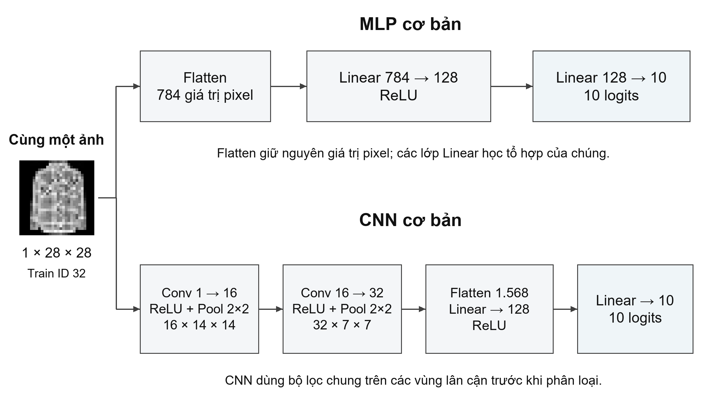

Hình 2.1 đặt hai đường tính toán cạnh nhau: MLP trải ảnh ngay từ đầu; CNN giữ hai chiều không gian trong các khối tích chập và pooling rồi mới Flatten. Cả hai cuối cùng đều tạo 10 logits. Vì vậy, có thể so sánh cùng nhiệm vụ và cùng ảnh, nhưng cần giữ nguyên quy trình dữ liệu để khác biệt quan sát được không đến từ cách chia tập.

Số tham số của Linear là số đầu vào nhân số đầu ra, cộng bias cho mỗi đầu ra. MLP có (784×128+128)+(128×10+10)=101.770 tham số. Đây là quy mô của kiến trúc cụ thể, không phải tính chất chung rằng mọi MLP đều lớn hơn hoặc nhỏ hơn CNN.

## 2.4 Tích chập và học đặc trưng cục bộ

Lớp tích chập dùng một kernel nhỏ trượt qua ảnh. Tại mỗi vị trí, các giá trị trong vùng ảnh được nhân với trọng số tương ứng rồi cộng lại để tạo một phần tử của feature map. Một kernel được dùng lại ở nhiều vị trí, gọi là chia sẻ trọng số. Với nhiều kênh đầu vào, mỗi bộ lọc kết hợp tất cả các kênh để tạo một kênh đầu ra. [2, 3]

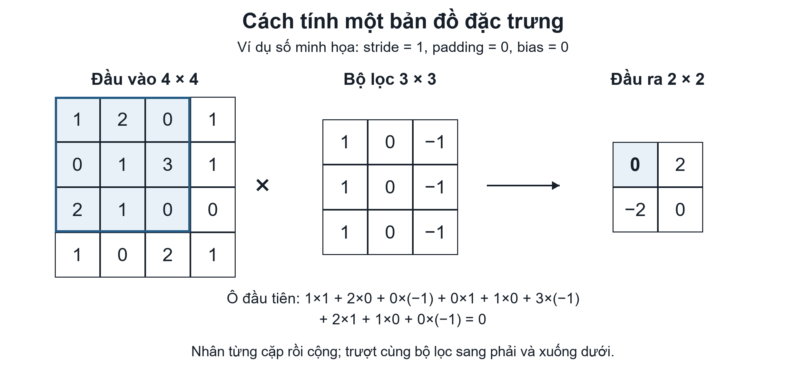

Trong Hình 2.2, ô đầu ra trên cùng bên trái bằng 1−0+0−3+2−0=0; dịch kernel một cột tạo giá trị 2. Đây là dữ liệu số tự chọn để minh họa phép tính, không phải kernel đã học hoặc kết quả huấn luyện. PyTorch Conv2d thực hiện phép tương quan chéo (cross-correlation), tức không lật kernel như định nghĩa tích chập toán học; trong mô tả mạng, tên lớp vẫn được gọi là tích chập. [3]

Kernel size xác định kích thước cửa sổ; stride là bước dịch; padding là phần viền thêm quanh ảnh. Khi dilation bằng 1, chiều cao đầu ra được tính như công thức dưới; chiều rộng tính tương tự. H là kích thước đầu vào, K là kernel size, P là padding và S là stride.

> H_out = floor((H + 2P − K) / S) + 1, với dilation = 1

CNN cơ bản dùng K=3, P=1, S=1 nên 28×28 được giữ nguyên sau Conv. Lớp đầu nhận 1 kênh và tạo 16 kênh; lớp tiếp theo nhận 16 và tạo 32. Một Conv 1→16 có bias chứa 16×(1×3×3+1)=160 tham số. Việc quét kernel qua nhiều vị trí không làm phát sinh bộ tham số mới cho từng vị trí.

Các lớp đầu có thể phản ứng với mẫu cục bộ như vùng sáng hoặc thay đổi biên; các lớp sau kết hợp thông tin từ vùng rộng hơn. Đây là cơ chế biểu diễn phân cấp, không có nghĩa mỗi kênh chắc chắn tương ứng một bộ phận quần áo có tên. Diễn giải feature maps phải dựa vào ảnh, lớp mạng, kênh và checkpoint cụ thể, như phần thực nghiệm ở chương 5.

## 2.5 Hàm kích hoạt ReLU và phép gộp Max Pooling

ReLU được định nghĩa bởi max(0, x): giữ giá trị dương và đưa giá trị âm về 0. Ví dụ [−2, 0, 3] trở thành [0, 0, 3]. Nó tạo tính phi tuyến mà vẫn có phép tính đơn giản. Sigmoid và tanh là các lựa chọn khác, nhưng có vùng bão hòa khi độ lớn đầu vào lớn; dự án dùng ReLU ở các tầng ẩn và không thực nghiệm so sánh ba hàm kích hoạt. [11]

> ReLU(x) = max(0, x)

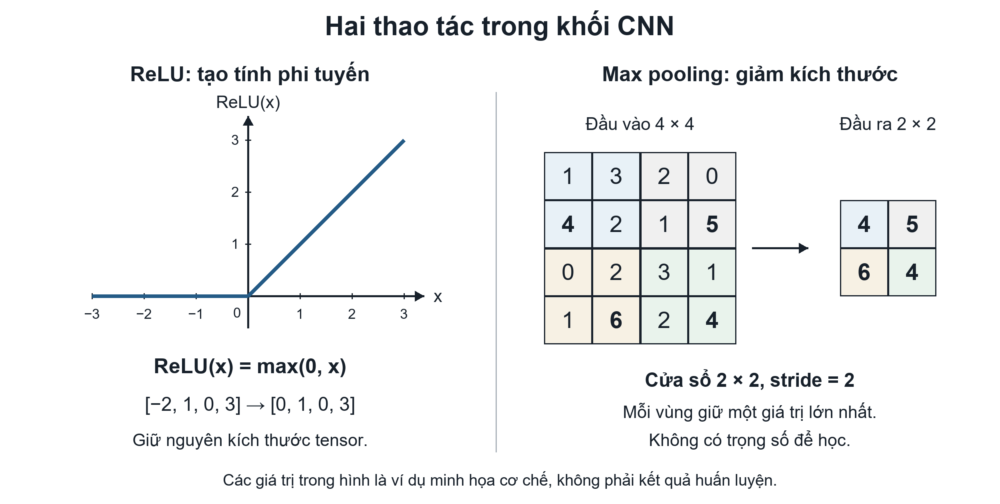

Max Pooling lấy giá trị lớn nhất trong từng vùng. Với kernel 2×2 và stride 2, một ma trận 4×4 trở thành 2×2 như Hình 2.3; phép gộp không có trọng số để học. Trong CNN của dự án, pooling lần thứ nhất đổi 28×28 thành 14×14, lần thứ hai đổi thành 7×7. Kích thước nhỏ hơn giúp giảm phần tính toán phía sau, nhưng cũng bỏ bớt thông tin vị trí chi tiết. [11]

Chia sẻ bộ lọc giúp CNN xử lý cùng loại mẫu ở nhiều vị trí; pooling có thể làm biểu diễn bớt nhạy với dịch chuyển nhỏ. Tuy nhiên, CNN có padding, pooling và các lớp cuối không bất biến hoàn toàn với mọi dịch chuyển, góc chụp hoặc biến dạng. Khả năng này cần được đo trên dữ liệu đánh giá thay vì suy ra chỉ từ tên kiến trúc.

| Thành phần | Biến đổi trong CNN cơ bản | Vai trò |
| --- | --- | --- |
| Conv + ReLU | 1×28×28 → 16×28×28 | Học và kích hoạt đặc trưng cục bộ |
| MaxPool lần 1 | 16×28×28 → 16×14×14 | Giảm độ phân giải không gian |
| Conv + ReLU + Pool | 16×14×14 → 32×7×7 | Kết hợp đặc trưng và tiếp tục giảm kích thước |
| Flatten + Linear | 1.568 → 128 → 10 | Tổng hợp đặc trưng thành logits |

*Bảng 2.1 Các thành phần nối tiếp trong CNN cơ bản*

## 2.6 Logits, softmax và hàm mất mát Cross-Entropy

Forward pass là quá trình truyền ảnh qua các lớp để tạo đầu ra. Mỗi ảnh của dự án nhận 10 logits, một điểm cho mỗi lớp. Logits không phải pixel, không bị giới hạn trong khoảng 0–1 và chưa phải xác suất. Lớp dự đoán là vị trí có logit lớn nhất. Softmax có thể chuyển các điểm thành các số dương có tổng bằng 1 để trình bày phân bố dự đoán. [4]

> p_j = exp(z_j) / Σ_k exp(z_k)

Để dễ tính, xét ví dụ ba lớp giả định có logits [2, 1, 0]. Softmax cho khoảng [0,6652; 0,2447; 0,0900]. Mạng ưu tiên lớp 0 nhưng vẫn gán điểm cho hai lớp khác. Đây chỉ là ví dụ ba lớp; mô hình thực tế luôn có 10 lớp. Chọn argmax trước hoặc sau softmax cho cùng nhãn, vì softmax giữ thứ tự các logits.

Với nhãn thật y, Cross-Entropy cho một ảnh là −ln(pᵧ). Nếu nhãn đúng trong ví dụ là 0, loss xấp xỉ 0,4076; nếu nhãn đúng là 2, loss xấp xỉ 2,4076. Hàm loss do đó phạt mạnh việc gán điểm thấp cho đáp án đúng. Loss của batch thường là trung bình loss các ảnh. Loss là mục tiêu tối ưu; nó không đồng nhất với tỷ lệ ảnh phân loại sai.

> L = −ln(p_y) = −z_y + ln(Σ_k exp(z_k))

Trong PyTorch, CrossEntropyLoss nhận trực tiếp logits và nhãn nguyên. Không áp dụng softmax trước hàm này, vì nó đã kết hợp phép tính tương đương log-softmax và negative log-likelihood theo cách ổn định số. Khi demo, softmax được dùng để hiển thị top 3; điểm cao chưa phải xác suất đã được hiệu chuẩn và vẫn có thể đi kèm dự đoán sai. [4]

## 2.7 Gradient, lan truyền ngược và Adam

Gradient của loss theo một trọng số mô tả độ nhạy tại trạng thái hiện tại: thay đổi nhỏ trọng số làm loss thay đổi theo hướng nào và mức nào. Backpropagation áp dụng quy tắc dây chuyền qua các lớp để tính gradient. Hàm loss không tự sửa trọng số; optimizer dùng các gradient đã tính để thực hiện bước cập nhật. [10]

Với cập nhật gradient descent đơn giản θ mới = θ cũ − ηg, gradient dương làm θ giảm và gradient âm làm θ tăng, khi learning rate η dương. Chẳng hạn θ=0,5, g=−0,2 và η=0,01 cho θ mới=0,502. Ví dụ này giải thích hướng đi theo gradient; nó không phải phép cập nhật Adam đầy đủ và không phải số liệu huấn luyện của dự án.

### Thuật toán Adam và một bước huấn luyện

Adam duy trì trung bình động của gradient m và của bình phương gradient v. Hai đại lượng này giúp kết hợp xu hướng các bước gần đây và điều chỉnh độ lớn cập nhật theo từng tham số. Hiệu chỉnh sai lệch được áp dụng vì m và v khởi đầu bằng 0. Trong công thức dưới, gₜ là gradient tại bước t, β₁ và β₂ là hệ số trung bình động, η là learning rate, ε là số nhỏ để ổn định phép chia. [5]

> m_t = β1 m_(t−1) + (1−β1)g_t

> v_t = β2 v_(t−1) + (1−β2)g_t²

> m_hat_t = m_t/(1−β1^t); v_hat_t = v_t/(1−β2^t)

> θ_t = θ_(t−1) − η m_hat_t/(sqrt(v_hat_t)+ε)

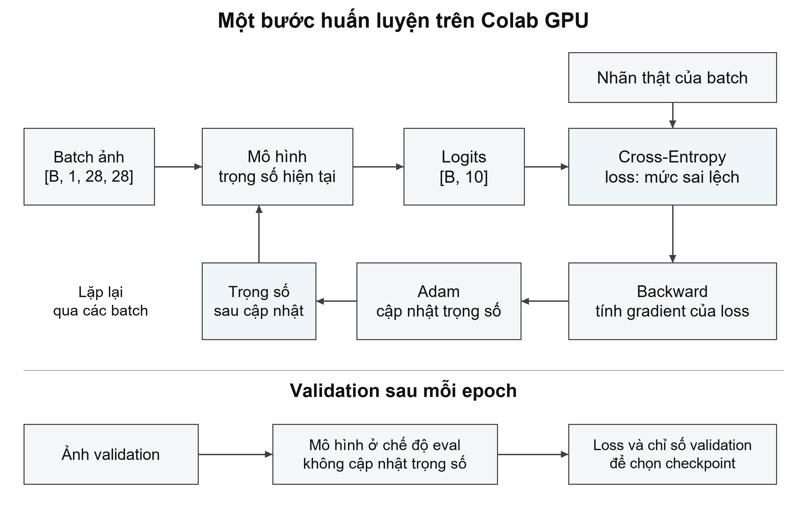

Hình 2.4 nối các khái niệm thành một bước học: lấy batch, xóa gradient cũ, forward, tính loss, backward rồi optimizer.step(). Trong dự án, Adam có learning rate ban đầu 0,001. zero_grad() cần thiết vì PyTorch tích lũy gradient vào tham số; nó không làm mất các trọng số đã học. [10]

Ở validation, mô hình chuyển sang eval() và tắt ghi gradient; chỉ tính đầu ra, loss và chỉ số. eval() thay đổi hành vi của Dropout và Batch Normalization, còn no_grad()/inference_mode() điều khiển theo dõi gradient. Hai thao tác có mục đích khác nhau và không thay thế nhau. Sau validation, vòng học tiếp theo phải đưa mô hình về train() trước khi cập nhật.

## 2.8 Khái quát hóa và các kỹ thuật điều chỉnh quá trình học

Underfitting xảy ra khi mô hình chưa học được quy luật đủ tốt, thể hiện qua chất lượng thấp ngay trên train. Overfitting là việc mô hình phù hợp quá nhiều với dữ liệu đã học nhưng hoạt động kém hơn trên dữ liệu đánh giá. Vì vậy cần theo dõi cả train và validation theo thời gian; một giá trị accuracy cao riêng lẻ chưa đủ để kết luận mô hình khái quát tốt.

Các kỹ thuật dưới đây tác động vào những phần khác nhau của hệ thống. Augmentation đổi ảnh train; Batch Normalization xử lý kích hoạt trong mạng; Dropout tạo nhiễu trên kích hoạt; scheduler và early stopping điều khiển tiến trình tối ưu. Chúng có thể tương tác với kiến trúc và dữ liệu, nên phải khảo sát hiệu quả thực tế thay vì mặc định cộng dồn lợi ích.

| Kỹ thuật | Cơ chế và cách dùng trong nghiên cứu |
| --- | --- |
| Augmentation | Tạo biến thể crop/lật ngang chỉ ở train, giữ nhãn. Mục đích là cho mô hình gặp các cách biểu diễn khác nhau của cùng lớp. |
| Batch Normalization | Chuẩn hóa kích hoạt theo batch và học hệ số scale/shift. Khi eval dùng thống kê tích lũy. CNNPlus đặt BN sau Conv. [6] |
| Dropout | Ngẫu nhiên bỏ một phần kích hoạt lúc train để giảm sự phụ thuộc vào một tổ hợp nơ-ron cố định. Khi eval không bỏ ngẫu nhiên. Dự án dùng p=0,3. [7] |
| Scheduler | Giảm learning rate khi validation loss chững lại; thay đổi độ lớn bước học, không thay đổi kiến trúc. |
| Early stopping | Dừng lượt huấn luyện khi validation loss không tiến bộ đủ theo patience/min_delta; tránh tiếp tục chạy chỉ vì còn ngân sách. |
| Checkpoint | Lưu trạng thái mô hình tại tiêu chí tốt nhất đã định. Có thể khác epoch cuối cùng của vòng học. |

*Bảng 2.2 Vai trò của các kỹ thuật trong quá trình huấn luyện*

Validation loss thấp hơn train loss không tự chứng minh có lỗi. Trong train, ảnh có thể được augmentation, Dropout đang bật và trọng số thay đổi qua từng batch; validation dùng trạng thái eval trên ảnh sạch. Để đánh giá khoảng cách khái quát hóa rõ hơn, có thể đo lại train sạch và validation ở cùng checkpoint và cùng chế độ eval. Cách đo này được dùng khi phân tích kết quả ở chương 5.

Các lựa chọn như kiến trúc, learning rate, batch size và augmentation là siêu tham số do người thiết kế quyết định; chúng khác với trọng số được optimizer học. Tuning là quá trình chọn siêu tham số bằng validation. Test không được dùng làm vòng phản hồi để tìm cấu hình hoặc seed đẹp hơn sau khi đã báo cáo.

## 2.9 Chỉ số đánh giá và phương pháp đối chứng

Accuracy là số dự đoán đúng chia tổng số ảnh. Với một lớp đang xét, TP là số ảnh đúng lớp được dự đoán đúng, FP là số ảnh lớp khác bị gán vào lớp đó, FN là số ảnh của lớp đó bị gán sang lớp khác. Precision xem độ chính xác của những lần mô hình gọi tên lớp; recall xem tỷ lệ mẫu thật của lớp được tìm đúng. [12]

> Precision = TP/(TP+FP); Recall = TP/(TP+FN)

> F1 = 2PR/(P+R); Macro-F1 = (Σ_k F1_k)/C, với C là số lớp

Trong công thức, C là số lớp (C=10 trong đề tài). Ví dụ minh họa, trong 100 ảnh thật của một lớp, mô hình tìm đúng 80 ảnh nhưng còn nhận nhầm 20 ảnh lớp khác vào lớp này. Khi đó TP=80, FN=20, FP=20; precision và recall đều là 80%, F1 cũng bằng 80%. Macro-F1 lấy trung bình F1 từng lớp với trọng số bằng nhau, nên giúp nhìn chất lượng các lớp thay vì chỉ dùng một tỷ lệ đúng chung. Ví dụ này không phải bảng kết quả Fashion-MNIST của nhóm.

Ma trận nhầm lẫn có hàng là nhãn thật và cột là nhãn dự đoán. Đường chéo chứa các ảnh đúng; mỗi ô ngoài đường chéo cho biết một chiều nhầm cụ thể. Tổng hàng là support của lớp, còn tổng đường chéo chia tổng toàn ma trận phải bằng accuracy. Nhầm A thành B và nhầm B thành A là hai số khác nhau. [12]

Đối chứng MLP/CNN trả lời câu hỏi về hai cách biểu diễn đầu vào. Ablation thay một thành phần của cấu hình để khảo sát tác động riêng, chẳng hạn thêm Dropout vào CNN. Nếu thay đồng thời nhiều thành phần như ở CNNPlus, không thể quy toàn bộ chênh lệch cho một kỹ thuật duy nhất. So sánh cũng cần công khai số tham số, ngân sách tối đa và số epoch thực chạy.

Seed kiểm soát các nguồn ngẫu nhiên như khởi tạo, thứ tự batch và augmentation. Lặp một cấu hình ở nhiều seed giúp mô tả độ dao động; giữ cùng split giúp tách phần dao động do quá trình học khỏi thay đổi chia dữ liệu. Trung bình và độ lệch chuẩn mẫu của ba seed không phải khoảng tin cậy và không thay thế cross-validation. Những giới hạn này được giữ khi diễn giải các kết quả nhỏ ở chương 5.

Các lý thuyết trên dẫn đến thiết kế thực nghiệm của nhóm: chuẩn hóa trên train, chọn bằng validation, báo cáo test có truy nguồn, quan sát đặc trưng và nạp lại checkpoint để kiểm tra. Mỗi thuật ngữ vì thế gắn với một thao tác trong chương trình và một loại bằng chứng, thay vì chỉ được liệt kê như tên kỹ thuật.

# CHƯƠNG 3. PHÂN TÍCH VÀ XỬ LÝ DỮ LIỆU

## 3.1 Fashion-MNIST và ánh xạ nhãn

Fashion-MNIST do Zalando Research công bố, gồm 60.000 ảnh ở tập train gốc và 10.000 ảnh test. Mỗi ảnh xám có kích thước 28×28 và một nhãn thuộc 10 lớp. Nhóm đọc dữ liệu bằng torchvision.datasets.FashionMNIST. Tổng dữ liệu là 70.000 ảnh. [1]

| Nhãn | Tên lớp gốc | Diễn giải tiếng Việt |
| --- | --- | --- |
| 0 | T-shirt/top | Áo thun hoặc áo phần thân trên |
| 1 | Trouser | Quần dài |
| 2 | Pullover | Áo chui đầu |
| 3 | Dress | Váy liền |
| 4 | Coat | Áo khoác |
| 5 | Sandal | Dép xăng đan |
| 6 | Shirt | Áo sơ mi |
| 7 | Sneaker | Giày thể thao |
| 8 | Bag | Túi |
| 9 | Ankle boot | Bốt cổ ngắn |

*Bảng 3.1 Ánh xạ mười lớp Fashion-MNIST*

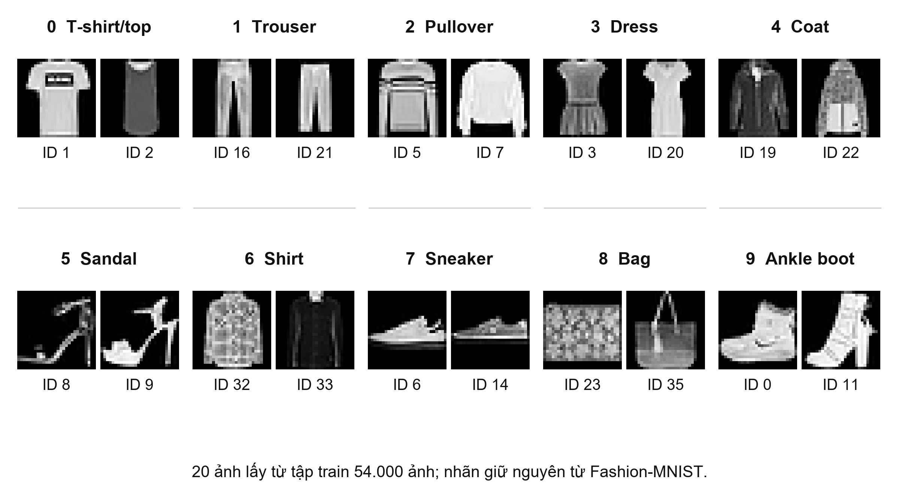

Hình 3.1 cho thấy biến thiên trong lớp và đường viền gần nhau giữa các lớp thân áo. Ảnh xám 28×28 giới hạn chi tiết và màu; đây là quan sát để đặt câu hỏi nghiên cứu, chưa đủ kết luận nguyên nhân lỗi.

## 3.2 Chia tập và kiểm soát rò rỉ dữ liệu

| Tập | Số ảnh | Mỗi lớp | Vai trò |
| --- | --- | --- | --- |
| Train | 54.000 | 5.400 | Cập nhật trọng số và tính mean/std |
| Validation | 6.000 | 600 | Theo dõi học và lựa chọn mô hình |
| Test | 10.000 | 1.000 | Đánh giá checkpoint đã chốt |

*Bảng 3.2 Phân chia dữ liệu và vai trò từng tập*

Từ 60.000 ảnh ban đầu, train_test_split chia theo nhãn với stratify và split seed 42. Tập ID train và validation không giao nhau; tất cả cấu hình dùng cùng split. Split được lưu vào splits.npz để kiểm tra lại. Thứ tự nhãn giữ nguyên từ dữ liệu đến checkpoint và demo.

Mean/std chỉ tính trên 54.000 ảnh train. Augmentation chỉ áp dụng ở train. Test được dùng báo cáo sau khi chốt cấu hình trong đợt lựa chọn; do test đã được xem trong giai đoạn học ban đầu, báo cáo không xem đây là một holdout hoàn toàn chưa biết.

## 3.3 Tiền xử lý và tăng cường dữ liệu

ToTensor chuyển ảnh sang tensor có dạng 1×28×28 và đổi giá trị từ thang 0–255 về 0–1. Normalize sau đó lấy từng giá trị trừ mean rồi chia std. Thống kê thực tế của train là mean=0,286209017 và std=0,353159755; validation, test và demo đều dùng lại hai số này.

Ví dụ pixel 128 trở thành khoảng 0,502 sau bước chia 255 và khoảng 0,611 sau chuẩn hóa. Chuẩn hóa thay cách biểu diễn số, không tạo nhãn mới và không phải một mô hình trích đặc trưng được huấn luyện.

Với cấu hình có augmentation, thứ tự là RandomCrop(28, padding=2), RandomHorizontalFlip(p=0,5), ToTensor và Normalize. Crop tạo dịch chuyển nhỏ nhờ thêm viền rồi cắt; lật ngang thay đổi hướng ảnh. Những biến đổi này chỉ áp dụng ngẫu nhiên lúc lấy ảnh train, không tăng số ID gốc trong split.

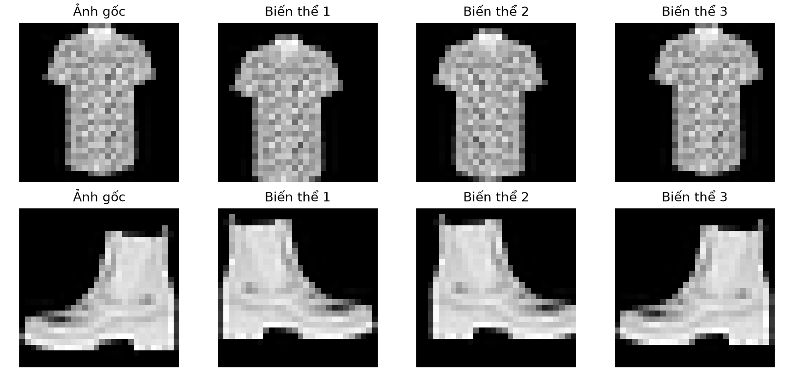

## 3.4 Tiền xử lý khác với học đặc trưng

Các phép ToTensor và Normalize được xác định trước khi học. Đặc trưng CNN là kết quả của các bộ lọc được điều chỉnh qua loss. Augmentation tác động lên ảnh đầu vào để tăng sự đa dạng; nó không thay thế quá trình học bộ lọc. Vì vậy, đánh giá đặc trưng cần quan sát kích hoạt của mạng đã train và liên hệ với lỗi phân loại.

Phần phân tích ở chương 5 dùng ảnh trung bình lớp để mô tả hình dáng và feature maps để quan sát kích hoạt. Nhóm chưa thực nghiệm HOG/SVM hoặc đặc trưng thủ công khác; các hướng này không được trình bày như kết quả đã hoàn thành.

# CHƯƠNG 4. XÂY DỰNG VÀ HUẤN LUYỆN HỆ THỐNG

## 4.1 Kiến trúc MLP và CNN cơ bản

MLP dùng Flatten → Linear(784,128) → ReLU → Linear(128,10), tổng 101.770 tham số. CNN cơ bản dùng Conv 1→16 → ReLU → Pool → Conv 16→32 → ReLU → Pool, sau đó Flatten → Linear(1.568,128) → ReLU → Linear(128,10), tổng 206.922 tham số. Các Conv của CNN cơ bản dùng kernel 3×3, padding 1 và có bias.

## 4.2 Kiến trúc CNNPlus được chọn

CNNPlus có hai khối, mỗi khối gồm hai Conv–BN–ReLU rồi MaxPool. Các Conv bỏ bias vì đi kèm BN. Sau Flatten là Linear 128, ReLU, Dropout 0,3 và Linear 10. B là số ảnh trong batch; bảng ghi kích thước sau từng nhóm thao tác.

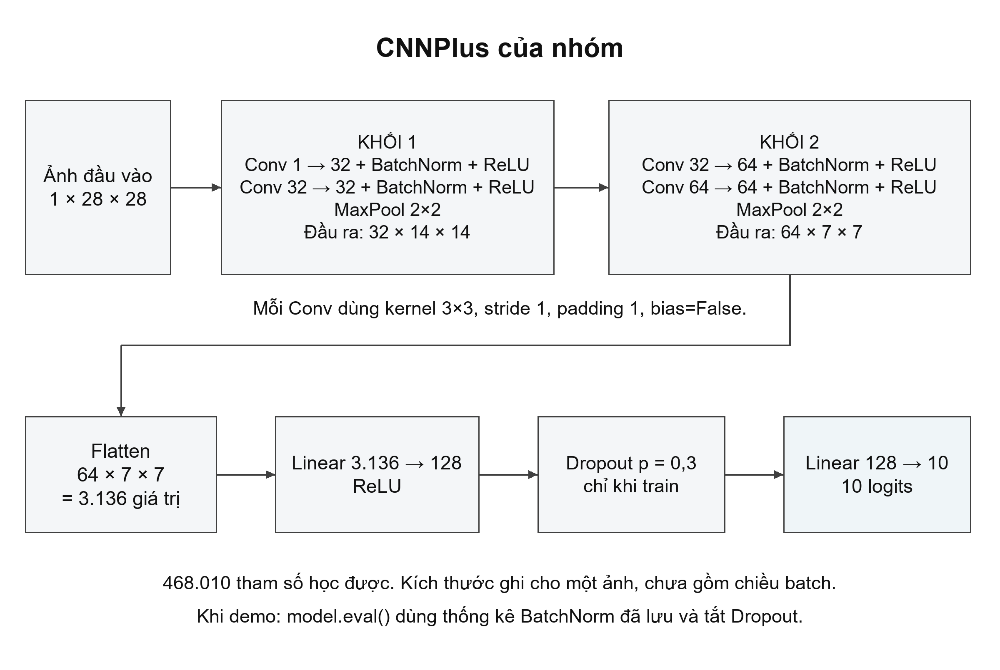

Hình 4.1 cho thấy hai khối trích đặc trưng nối với bộ phân loại. Hai Conv liên tiếp trong mỗi khối kết hợp thông tin trước khi pooling giảm kích thước. Sau hai lần pooling, 64×7×7 được Flatten thành 3.136 giá trị; phần Linear tạo 128 kích hoạt rồi 10 logits. Dropout chỉ nằm ở phần phân loại của CNNPlus.

### Kích thước và số tham số của CNNPlus

| Nhóm lớp | Đầu ra | Tham số |
| --- | --- | --- |
| Đầu vào | B×1×28×28 | 0 |
| Conv 1→32 + BN + ReLU | B×32×28×28 | 352 |
| Conv 32→32 + BN + ReLU | B×32×28×28 | 9.280 |
| MaxPool 2×2 | B×32×14×14 | 0 |
| Conv 32→64 + BN + ReLU | B×64×14×14 | 18.560 |
| Conv 64→64 + BN + ReLU | B×64×14×14 | 36.992 |
| MaxPool 2×2 và Flatten | B×3.136 | 0 |
| Linear 3.136→128 + ReLU | B×128 | 401.536 |
| Dropout p=0,3 | B×128 | 0 |
| Linear 128→10 | B×10 logits | 1.290 |
| Tổng cộng |  | 468.010 |

*Bảng 4.1 Kiến trúc CNNPlus và số tham số*

Riêng Linear 3.136→128 có 3.136×128+128=401.536 tham số, chiếm khoảng 85,8% tổng số. CNNPlus đạt chất lượng cao hơn trong tập cấu hình đã thử nhưng cũng có nhiều tham số hơn các đối chứng. Vì vậy phép so sánh không phải một thí nghiệm giữ cố định ngân sách tham số.

## 4.3 Cấu trúc mã và đường đi của dữ liệu

| File hoặc thư mục | Trách nhiệm |
| --- | --- |
| data/chuan_bi_du_lieu.py | Tải dữ liệu, chia ID, tính mean/std và tạo DataLoader. |
| models/kien_truc_mo_hinh.py | Định nghĩa MLP, CNN và các biến thể. |
| training/vong_lap_huan_luyen.py | Chạy train/validation, lưu checkpoint và lịch sử. |
| training/chon_mo_hinh.py | Điều phối các cấu hình, chọn mô hình và đo test. |
| evaluation/danh_gia_mo_hinh.py | Tính chỉ số, lưu predictions và ma trận nhầm lẫn. |
| evaluation/phan_tich_ket_qua.py | Đối chiếu kết quả, phân tích lỗi và feature maps. |
| models/du_doan.py | Nạp checkpoint và tiền xử lý ảnh cho suy luận. |
| demo/so_sanh_mo_hinh.py | Dự đoán cùng ảnh bằng ba mô hình và xuất hình. |
| notebooks/ | Học từng bước, điều phối Colab và trình bày demo. |
| experiments/runs/ | Trọng số, cấu hình, split, log và kết quả gốc theo run. |

*Bảng 4.2 Cấu trúc mã nguồn theo chức năng*

File điều phối đọc cấu hình rồi gọi prepare_data. Hàm fit tạo mô hình, optimizer và DataLoader, sau đó chạy từng epoch. Checkpoint chứa tên kiến trúc, state_dict, mean/std và danh sách lớp. Phần demo nạp lại các thông tin này, gọi model.eval() và torch.inference_mode() để suy luận với trọng số cố định.

## 4.4 Kết nối máy và Colab

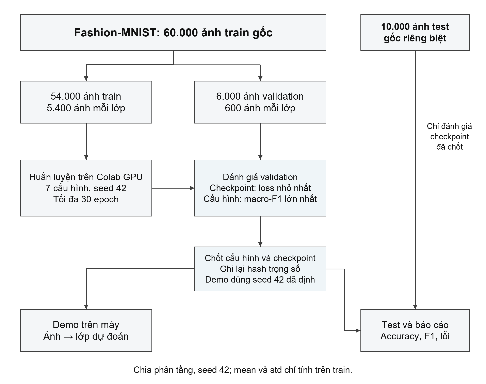

Trong Hình 4.2, chỉ train tạo gradient. Validation cung cấp tiêu chí theo dõi và lựa chọn, còn test nhận checkpoint đã chốt. Máy cá nhân nhận artifact để kiểm chứng và demo, không tiếp tục cập nhật trọng số. Mối liên kết giữa notebook, các module Python và checkpoint giúp chạy lại suy luận mà không cần train lại.

Mã được sửa trên máy, đóng thành experiments/source.zip bằng scripts/dong_goi_colab.py rồi upload vào /content trên Colab. Notebook 05_chon_mo_hinh.ipynb giải nén mã, kiểm tra CUDA và gọi module training.chon_mo_hinh. Huấn luyện chạy trên GPU Tesla T4; bản kết quả chính được hoàn thành ngày 04/11/2026.

Sau thực nghiệm, ZIP của run được tải về experiments/runs trên máy. Các checkpoint dùng demo được đối chiếu hash với bản gốc. Mã hiện hành đã đổi tên và format ngày 07–08/11; đây không phải một lần train mới. Snapshot mã dùng lúc train được giữ cùng artifact để truy nguồn.

Môi trường thực nghiệm đã ghi nhận: PyTorch 2.11.0+cu130, torchvision 0.26.0+cu130, scikit-learn 1.6.1, GPU Tesla T4. Lưu notebook trên Drive và tải ZIP kết quả là hai việc riêng; ZIP chứa trọng số và các tệp cần để chạy lại phần đánh giá.

## 4.5 Giao thức lựa chọn mô hình

| Thiết lập | Giá trị |
| --- | --- |
| Split và seed ban đầu | 54k/6k/10k; split seed 42; train seed 42 |
| Optimizer và learning rate | Adam; learning rate khởi tạo 0,001 |
| Batch và ngân sách | Batch 128; tối đa 30 epoch mỗi lượt |
| Scheduler | ReduceLROnPlateau: patience 2, factor 0,5, min_lr 0,00001 |
| Dừng sớm | Patience 6; min_delta 0,0001 |
| Checkpoint của từng lượt | Epoch có validation loss nhỏ nhất |
| Cấu hình thắng | Macro-F1 validation cao nhất; hòa thì ưu tiên loss thấp hơn |
| Kiểm tra độ dao động | Cấu hình thắng chạy thêm seed 123 và 2026 |
| Checkpoint cho demo | Seed 42 đã định trước; không chọn seed theo test |

*Bảng 4.3 Thiết lập giao thức lựa chọn mô hình*

## 4.6 Bảy cấu hình và phạm vi so sánh

Bảy cấu hình ban đầu gồm MLP, CNN, CNN+Dropout, CNN+BatchNorm, CNN+augmentation, CNNPlus và CNNPlus+augmentation. Ba biến thể đầu của CNN chỉ thay một yếu tố, giúp quan sát tác động riêng trong điều kiện thí nghiệm. CNNPlus thay nhiều yếu tố cùng lúc, vì vậy không thể quy toàn bộ mức cải thiện cho một thành phần duy nhất.

Các cấu hình có cùng split, batch, optimizer, trần epoch và quy tắc checkpoint. Số epoch thực chạy và thời gian có thể khác nhau do early stopping. Số tham số cũng khác nhau; kết quả phản ánh lựa chọn kiến trúc trong ngân sách thử nghiệm, không chứng minh một kiến trúc luôn vượt mọi mô hình khác.

## 4.7 Chọn checkpoint khác với dừng sớm

Code lưu checkpoint nếu validation loss nhỏ hơn giá trị tốt nhất đã có, kể cả mức giảm nhỏ. Bộ đếm early stopping chỉ được đặt lại khi mức giảm vượt min_delta so với mốc theo dõi. Vì thế, một epoch có thể tạo checkpoint tốt hơn nhưng chưa đủ để làm mới bộ đếm dừng sớm. Cấu hình thắng vẫn được lựa chọn trên chỉ số của checkpoint đã lưu.

Sau khi chốt cấu hình và checkpoint, test được dùng để báo cáo. Các ảnh test sai chỉ phục vụ phân tích và demo trong báo cáo này, không dùng để mở vòng điều chỉnh mới. Kết quả ba seed được báo cáo bằng trung bình và độ lệch chuẩn mẫu, không phải khoảng tin cậy hoặc cross-validation.

# CHƯƠNG 5. THỰC NGHIỆM VÀ ĐÁNH GIÁ

## 5.1 So sánh bảy cấu hình trên validation

| Cấu hình | Epoch tốt/đã chạy | Acc val | F1 val | Giây |
| --- | --- | --- | --- | --- |
| mlp | 15/21 | 90,13% | 90,14% | 259,4 |
| cnn | 15/21 | 92,98% | 92,97% | 279,5 |
| cnn_dropout | 16/22 | 93,30% | 93,29% | 293,5 |
| cnn_batchnorm | 7/13 | 92,47% | 92,47% | 173,8 |
| cnn_aug | 24/30 | 92,90% | 92,90% | 559,2 |
| cnn_plus | 8/14 | 93,62% | 93,55% | 201,0 |
| cnn_plus_aug | 30/30 | 94,33% | 94,30% | 588,7 |

*Bảng 5.1 Kết quả validation của bảy cấu hình*

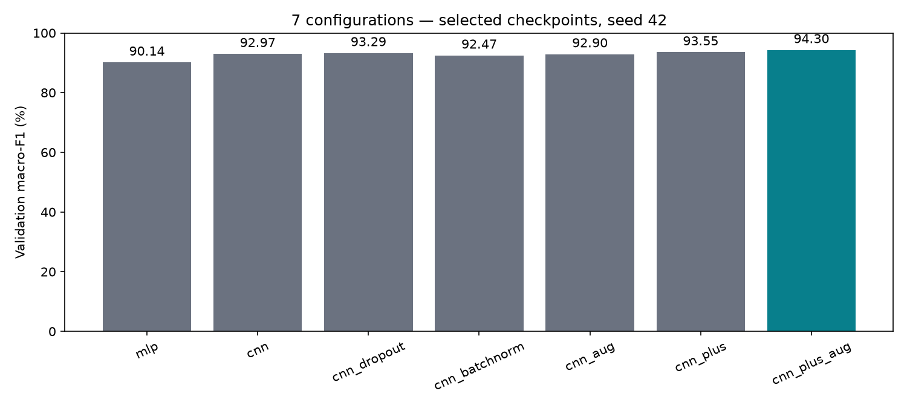

Trong các đối chứng một yếu tố, Dropout tăng macro-F1 khoảng 0,31 điểm phần trăm so với CNN gốc; BatchNorm giảm khoảng 0,50 và augmentation riêng giảm khoảng 0,07. Những thay đổi không cải thiện vẫn được giữ trong báo cáo. Một seed chưa đủ để kết luận ý nghĩa thống kê của các khác biệt nhỏ.

CNNPlus+augmentation đạt macro-F1 validation 94,30%, cao nhất trong bảy cấu hình ban đầu. So với CNNPlus không augmentation, mức tăng khoảng 0,75 điểm phần trăm. Hai seed xác nhận được chạy sau lựa chọn và không dùng để đổi checkpoint demo.

## 5.2 Test và độ dao động theo seed

| Cấu hình | Seed | Accuracy test | Macro-F1 test |
| --- | --- | --- | --- |
| mlp | 42 | 88,55% | 88,55% |
| cnn | 42 | 92,11% | 92,09% |
| cnn_plus_aug | 42 | 93,70% | 93,66% |
| cnn_plus_aug_seed123 | 123 | 93,84% | 93,83% |
| cnn_plus_aug_seed2026 | 2026 | 93,87% | 93,81% |

*Bảng 5.2 Kết quả test và các seed xác nhận*

Ở seed 42, CNNPlus đạt 9.370/10.000 ảnh đúng, tương ứng 93,70%; cao hơn CNN cơ bản 1,59 điểm phần trăm và MLP 5,15 điểm phần trăm. Đây là chênh lệch trong cùng giao thức dữ liệu; số tham số của các kiến trúc khác nhau nên chưa tách riêng được ảnh hưởng của quy mô mô hình.

Ba seed của cấu hình được chọn có accuracy trung bình 93,80%, độ lệch chuẩn mẫu 0,091 điểm phần trăm; macro-F1 trung bình 93,77%, độ lệch chuẩn 0,091 điểm phần trăm. Seed demo vẫn là 42.

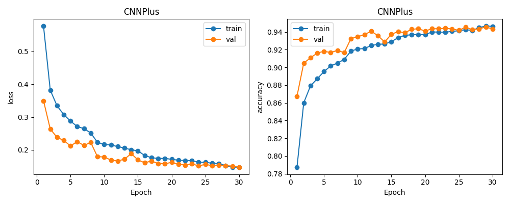

Checkpoint tốt nhất nằm ở epoch 30, cũng là giới hạn ngân sách. Không thể suy ra đã hội tụ hoàn toàn. Validation loss thường thấp hơn train loss vì train có augmentation, Dropout và trọng số thay đổi trong epoch. Khi đo lại cùng checkpoint ở eval trên ảnh sạch, accuracy train là 96,20% và validation là 94,33%, chênh 1,86 điểm phần trăm; khoảng cách này không chứng minh tuyệt đối rằng mô hình không overfit.

## 5.3 Chỉ số theo lớp của checkpoint demo

| Lớp | Precision | Recall | F1 | Số ảnh |
| --- | --- | --- | --- | --- |
| T-shirt/top | 88,02% | 90,40% | 89,20% | 1000 |
| Trouser | 99,20% | 99,30% | 99,25% | 1000 |
| Pullover | 90,33% | 92,50% | 91,40% | 1000 |
| Dress | 93,70% | 93,70% | 93,70% | 1000 |
| Coat | 89,81% | 91,70% | 90,75% | 1000 |
| Sandal | 99,00% | 98,70% | 98,85% | 1000 |
| Shirt | 83,48% | 77,30% | 80,27% | 1000 |
| Sneaker | 95,71% | 98,10% | 96,89% | 1000 |
| Bag | 99,00% | 99,30% | 99,15% | 1000 |
| Ankle boot | 98,36% | 96,00% | 97,17% | 1000 |

*Bảng 5.3 Chỉ số theo lớp của CNNPlus seed 42*

Shirt là lớp yếu nhất: recall 77,30% tương ứng 773 ảnh đúng và 227 ảnh sai trên 1.000 ảnh. Precision của lớp này là 83,48%, nghĩa là vẫn có nhiều ảnh thuộc lớp khác bị dự đoán thành Shirt. Accuracy chung 93,70% không thể thay thế việc xem kỹ nhóm lỗi này.

## 5.4 Các cặp nhầm có hướng

| Nhãn thật | Dự đoán | Số ảnh nhầm |
| --- | --- | --- |
| Shirt | T-shirt/top | 94 |
| T-shirt/top | Shirt | 70 |
| Shirt | Coat | 59 |
| Shirt | Pullover | 43 |
| Coat | Shirt | 35 |
| Ankle boot | Sneaker | 34 |
| Coat | Pullover | 33 |

*Bảng 5.4 Các cặp nhầm lẫn có hướng*

Chiều Shirt → T-shirt/top có 94 ảnh, còn chiều ngược lại có 70 ảnh. Không gộp hai con số rồi mô tả như một chiều. Trong 227 ảnh Shirt sai, 94 bị nhận thành T-shirt/top, 59 thành Coat và 43 thành Pullover. Các lớp thân áo có hình dáng gần nhau là giả thuyết phù hợp với lỗi quan sát được; đây chưa phải chứng minh nguyên nhân của từng quyết định.

## 5.5 Đối chiếu ma trận nhầm lẫn

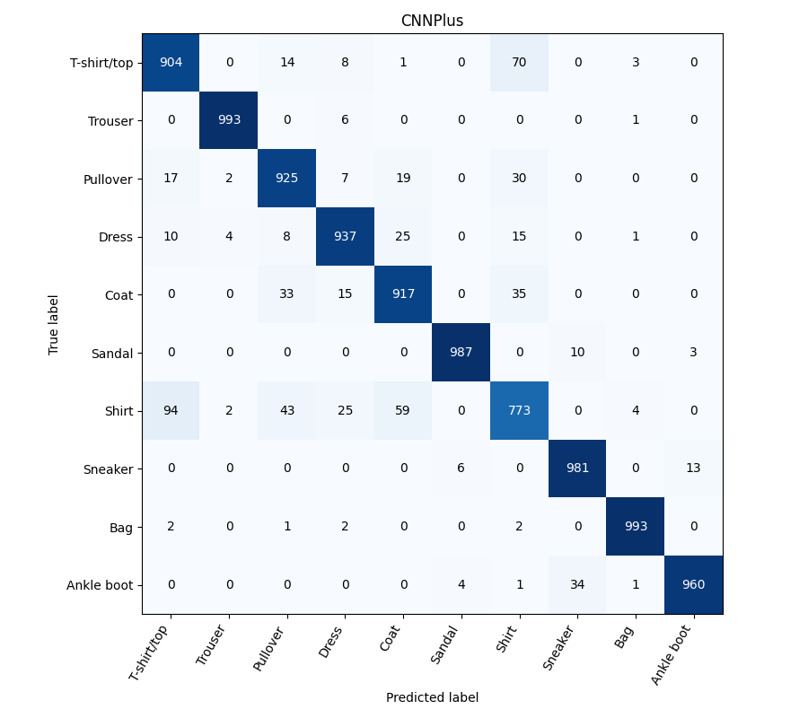

Tổng các ô của ma trận là 10.000; tổng đường chéo là 9.370, khớp accuracy 93,70%. Mỗi hàng có tổng 1.000, khớp support từng lớp. Việc đối chiếu này giúp tránh mâu thuẫn giữa bảng, hình và lời nhận xét.

## 5.6 Phân tích ảnh sai có điểm dự đoán cao

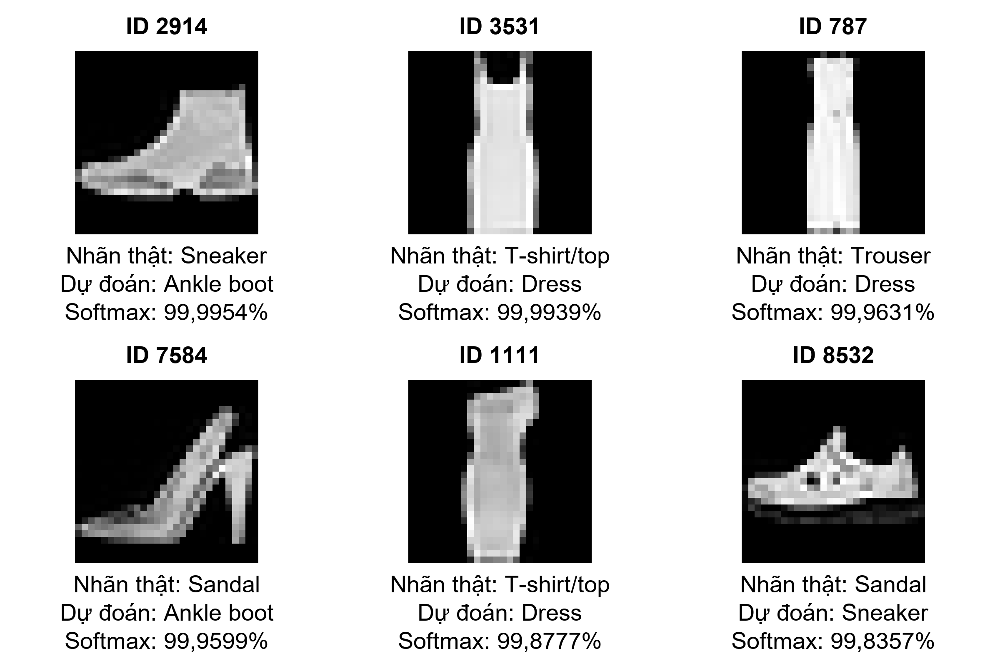

Các ví dụ trên cho thấy điểm softmax có thể rất cao dù đáp án sai. Softmax chuyển logits thành các điểm tổng bằng 1, nhưng dự án chưa hiệu chuẩn xác suất. Khi trình bày demo, cần đọc nhãn thật, dự đoán và giới hạn dữ liệu cùng nhau.

Các ảnh được lấy từ bảng predictions của chính checkpoint demo, theo thứ tự điểm cao trong nhóm dự đoán sai. Do đã lọc theo lỗi và điểm số, hình này không phản ánh tỷ lệ xuất hiện của các lớp trong toàn bộ tập test. Accuracy phải được tính trên đủ 10.000 ảnh, không suy ra từ tập minh họa đã chọn.

ID 2914 có nhãn Sneaker nhưng được nhận thành Ankle boot. Hình dáng cổ giày là một giả thuyết trực quan về sự gần nhau của hai lớp; không đủ bằng chứng để kết luận nhãn gốc sai. Việc giữ nguyên ví dụ thất bại trong demo giúp trình bày trung thực phạm vi hoạt động của mô hình.

## 5.7 Phân tích hình dáng và đặc trưng học được

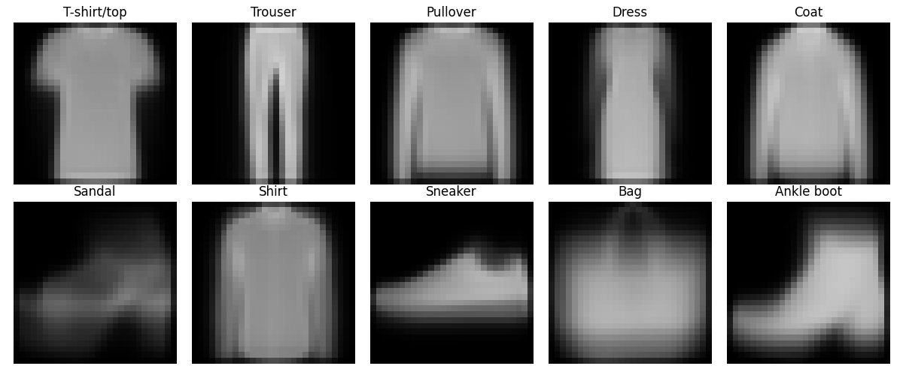

Ảnh trung bình cho thấy quần có hai dải dọc, túi có thân rộng, còn Shirt/Pullover/Coat đều có thân và tay áo tương đối giống nhau. Tuy nhiên, phép lấy trung bình làm mờ cổ áo, khuy và họa tiết. Đây là thống kê mô tả dữ liệu, không phải một phương pháp học đặc trưng mới.

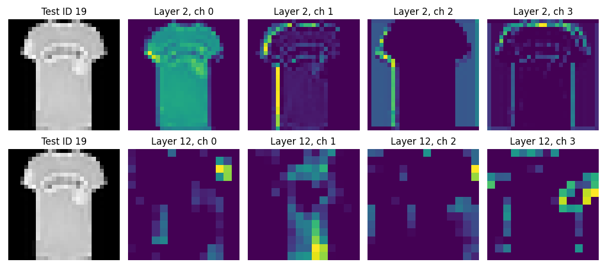

Tầng features.2 giữ kích thước 28×28; một số kênh làm nổi vùng thân và biên ảnh. Tầng features.12 có kích thước 14×14, cho các cụm kích hoạt khác nhau sau xử lý ở nhiều tầng. Các bộ lọc này được học qua loss, thay vì được đặt thủ công để tìm một chi tiết quần áo cụ thể.

## 5.8 Đặc trưng trên ảnh sai và giới hạn diễn giải

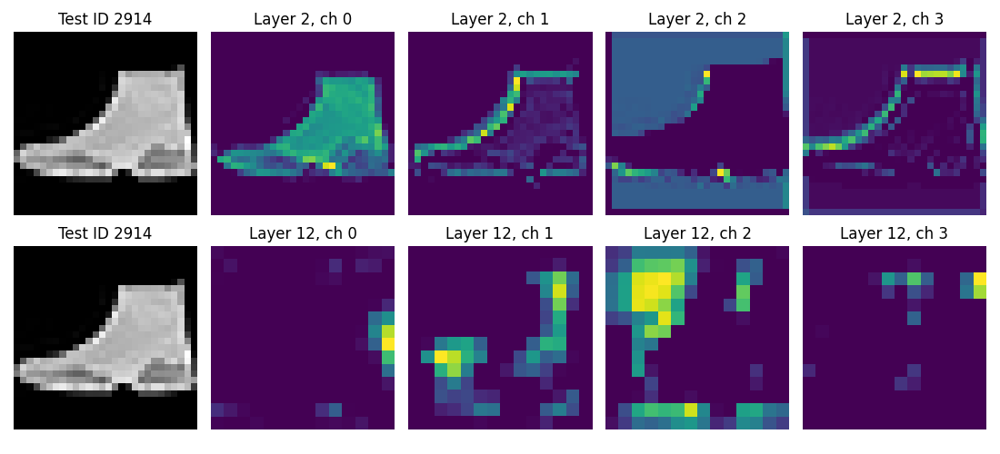

Ở ảnh sai, mạng vẫn tạo kích hoạt rõ. Hình không chứng minh một kênh cụ thể gây lỗi hoặc nhãn gốc sai. Mỗi kênh dùng thang màu riêng; không so độ sáng tuyệt đối giữa các kênh. Phân tích hiện bao gồm 6 ảnh, 2 tầng và 4 kênh mỗi tầng, nên chưa đại diện mọi đặc trưng của mạng.

| Thông tin quan sát | Cách diễn giải phù hợp |
| --- | --- |
| Tầng features.2, kênh 0–3 | Kích hoạt sớm 28×28; quan sát các vùng sáng và biên phản ứng. |
| Tầng features.12, kênh 0–3 | Kích hoạt 14×14 sau nhiều lớp; thông tin đã được kết hợp trong vùng ảnh rộng hơn. |
| Ảnh đúng ID19 và ảnh sai ID2914 | So sánh hành vi trên hai kết quả khác nhau, không dùng để chứng minh nguyên nhân. |
| Metadata của hình | Lưu ID, tầng, kênh và hash checkpoint để có thể tái lập quan sát. |

*Bảng 5.5 Quan sát đặc trưng và giới hạn diễn giải*

Phân tích này bổ sung phần học đặc trưng vào quy trình dữ liệu: thay vì chỉ liệt kê Normalize hoặc augmentation, báo cáo chỉ ra đầu vào nào tạo kích hoạt ở tầng nào và đối chiếu với dự đoán. Tuy nhiên, việc một vùng ảnh tạo kích hoạt mạnh chưa đủ chứng minh vùng đó quyết định lớp cuối cùng.

Để kiểm tra giả thuyết nguyên nhân trong nghiên cứu tiếp theo, có thể thiết kế phép che vùng hoặc nhiễu có kiểm soát và đo thay đổi đầu ra theo một giao thức định trước. Đây là hướng phát triển chưa được thực hiện trong kết quả báo cáo này.

## 5.9 Kiểm chứng lại và demo offline

Ngày 08/11/2026, nhóm kiểm chứng lại phần mềm với trọng số cố định. Ba mô hình MLP, CNN và CNNPlus được suy luận lại trên toàn bộ 10.000 ảnh test bằng CPU. Cả 30.000 nhãn dự đoán trùng kết quả đã lưu từ Colab; sai lệch xác suất lớn nhất khoảng 0,000004752. Không có bước cập nhật trọng số trong lần kiểm tra này.

| Kiểm tra | Kết quả |
| --- | --- |
| Import, cú pháp notebook, định dạng mã | Đạt |
| Split, thống kê train và hash dữ liệu | Đạt |
| Hash checkpoint demo so với artifact | Khớp |
| 5 bảng test và 9 lịch sử/split | Đối chiếu nhất quán |
| Ảnh sai định dạng, đầu ra hữu hạn, eval cố định | Đạt |

*Bảng 5.6 Kết quả kiểm chứng phần mềm*

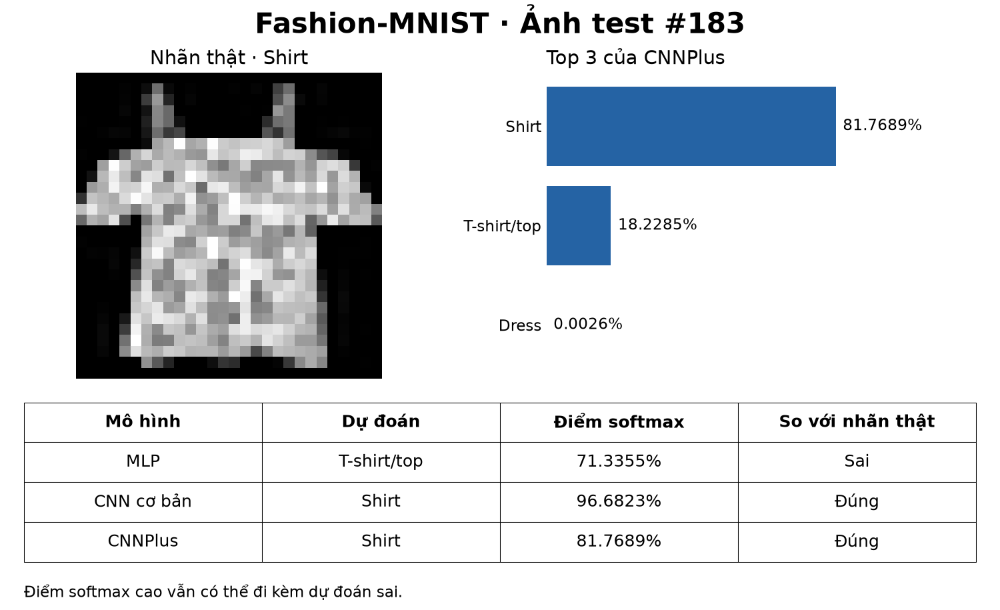

Demo nạp checkpoint và ảnh mẫu, chạy suy luận thật rồi xuất hình so sánh. Ảnh ID 183 có nhãn Shirt: MLP đoán T-shirt/top, hai CNN đoán đúng. Ảnh ID 2914 là Sneaker nhưng CNNPlus đoán Ankle boot với điểm khoảng 99,9954%; ví dụ này dùng để trình bày giới hạn. Hai ảnh được chọn có chủ đích minh họa, không dùng ước lượng accuracy.

# CHƯƠNG 6. KẾT LUẬN VÀ HƯỚNG PHÁT TRIỂN

## 6.1 Kết quả đạt được

Nhóm đã xây dựng quy trình từ chia dữ liệu, chuẩn hóa, huấn luyện đến đánh giá và demo. Các phần mã được tách theo chức năng, checkpoint giữ thông tin tiền xử lý và các kết quả có thể truy về cùng run. CNNPlus+augmentation là cấu hình tốt nhất theo macro-F1 validation trong bảy cấu hình đã thử, đạt accuracy test 93,70% ở seed demo 42.

So sánh MLP, CNN cơ bản và CNNPlus cho thấy chất lượng tăng cùng với thay đổi kiến trúc và kỹ thuật huấn luyện, nhưng chi phí tham số cũng tăng. Các đối chứng không cải thiện được báo cáo cùng các đối chứng cải thiện. Phân tích đặc trưng được mở rộng từ tiền xử lý sang quan sát dữ liệu, kích hoạt nhiều tầng và liên hệ lỗi phân loại.

## 6.2 Hạn chế

Các đối chứng ban đầu chỉ có một seed; ba seed mới áp dụng cho cấu hình được chọn. Số tham số và số epoch thực chạy khác nhau giữa mô hình. Test đã từng được xem trong giai đoạn học ban đầu nên không phải một holdout hoàn toàn chưa biết. Checkpoint demo chạm trần 30 epoch, chưa chứng minh hội tụ hoàn toàn.

Shirt còn recall thấp; các bản đồ kích hoạt không cung cấp lời giải thích nhân quả. Mô hình chưa được đánh giá trên ảnh điện thoại, ảnh màu hoặc nền phức tạp, và điểm softmax chưa hiệu chuẩn. Vì vậy sản phẩm phù hợp minh họa bài toán Fashion-MNIST trong học phần; chưa đủ bằng chứng cho triển khai phân loại ảnh thương mại điện tử thực tế.

## 6.3 Hướng phát triển có thể kiểm chứng

Nếu mở nghiên cứu mới, nhóm cần định nghĩa giao thức và tập đánh giá phù hợp trước khi thử thêm. Các hướng ưu tiên gồm lặp nhiều seed cho các đối chứng, khảo sát sai lệch trên nhóm Shirt, đo độ bền với dịch chuyển/nhiễu có kiểm soát và đánh giá dữ liệu ngoài phân phối. Việc hiệu chuẩn xác suất cần tập validation riêng hoặc cách chia phù hợp, không dùng test để tinh chỉnh.

Về sản phẩm, có thể bổ sung giao diện chọn ảnh và cảnh báo đầu vào không phù hợp, hoặc đóng gói mô hình để chạy trên máy khác. Tuy nhiên, trước mỗi mở rộng cần đo tác động thực tế; tăng độ phức tạp hay số epoch không tự bảo đảm tăng chất lượng.

## 6.4 Yêu cầu và kết quả thực hiện

Bảng dưới đối chiếu yêu cầu trong phạm vi nghiên cứu với kết quả và tệp kiểm chứng. Các tiêu chí thể hiện chức năng, tính nhất quán của dữ liệu và khả năng tái lập; nhóm không đặt một ngưỡng accuracy hậu nghiệm để thay thế đánh giá đầy đủ.

| Yêu cầu | Kết quả thực hiện và bằng chứng |
| --- | --- |
| R1. Đầu vào và đầu ra rõ ràng | Ảnh xám 28×28; đầu ra 10 logits và top 3 khi demo. Kiểm thử từ chối ảnh sai mode/kích thước, đầu ra hữu hạn. |
| R2. Quy trình dữ liệu nhất quán | 54k/6k/10k, tương ứng 5.400/600/1.000 ảnh mỗi lớp. ID train/validation không giao nhau; split lưu để kiểm tra. |
| R3. Tiền xử lý và môi trường | Mean/std chỉ từ train; validation/test/demo dùng cùng thống kê. Các thí nghiệm lựa chọn mô hình chạy trên Colab GPU; kiểm chứng ngày 08/11 chỉ suy luận. |
| R4. Đối chứng và lựa chọn mô hình | Bảy cấu hình: MLP, CNN và các biến thể. Cùng split 42, batch 128, Adam 0,001, tối đa 30 epoch; chọn bằng validation, kiểm tra thêm hai seed. |
| R5. Phân tích và đánh giá đầy đủ | Lưu 10.000 dự đoán cho từng checkpoint test; accuracy, macro-F1, support và ma trận khớp nhau. Có ảnh trung bình lớp và feature maps hai tầng. |
| R6. Demo và tái lập | 30.000 nhãn dự đoán lại khớp Colab; hash checkpoint giữ nguyên. Demo có ảnh đúng ID 183 và ảnh sai ID 2914, không cập nhật trọng số. |

*Bảng 6.1 Yêu cầu và kết quả thực hiện*

Biên bản kiểm chứng ngày 08/11/2026 xác nhận các phép kiểm tra phần mềm nêu trên. Kết quả này chứng minh mô hình lưu trên máy hoạt động nhất quán với artifact huấn luyện; không thay thế đánh giá trên dữ liệu ngoài Fashion-MNIST.

## 6.5 Các cải tiến và ý nghĩa thực nghiệm

| Thay đổi | Kết quả đo và phạm vi kết luận |
| --- | --- |
| CNN so với MLP | Accuracy test 92,11% so với 88,55%, tăng 3,56 điểm phần trăm. Kết quả gắn với hai kiến trúc và số tham số cụ thể. |
| Dropout, BN, augmentation riêng | Macro-F1 validation thay đổi lần lượt +0,31; −0,50; −0,07 điểm phần trăm so với CNN. Mỗi đối chứng mới có một seed. |
| CNNPlus và augmentation | Macro-F1 validation tăng từ 93,55% lên 94,30% khi thêm augmentation vào CNNPlus. Ba seed đạt accuracy test 93,80% ± 0,091 điểm phần trăm (độ lệch chuẩn mẫu). |
| Scheduler và early stopping | Điều khiển learning rate và ngân sách theo validation loss. Chưa có đối chứng riêng để định lượng phần tăng chất lượng do từng cơ chế. |
| Phân tích đặc trưng và mã nguồn | Trực quan hóa 2 tầng × 4 kênh trên 6 ảnh, lưu metadata; tách mã theo chức năng, đóng gói Colab và kiểm tra lại. Đây là cải thiện khả năng quan sát và tái lập, chưa chứng minh làm tăng accuracy. |

*Bảng 6.2 Các cải tiến và bằng chứng thực nghiệm*

Những cải tiến có kết quả âm vẫn được giữ trong báo cáo. CNNPlus thay đổi đồng thời nhiều thành phần và có 468.010 tham số, vì vậy chưa thể quy toàn bộ hiệu quả cho riêng Batch Normalization, Dropout hoặc độ sâu mạng.

# TÀI LIỆU THAM KHẢO

[1] Zalando Research. Fashion-MNIST. Bộ dữ liệu và ánh xạ 10 lớp. https://github.com/zalandoresearch/fashion-mnist

[2] Stanford CS231n. Convolutional Neural Networks. https://cs231n.github.io/convolutional-networks/

[3] PyTorch. Conv2d API. https://docs.pytorch.org/docs/2.11/generated/torch.nn.Conv2d.html

[4] PyTorch. CrossEntropyLoss API. https://docs.pytorch.org/docs/2.11/generated/torch.nn.CrossEntropyLoss.html

[5] D. P. Kingma và J. Ba. Adam: A Method for Stochastic Optimization. ICLR, 2015. https://arxiv.org/abs/1412.6980

[6] S. Ioffe và C. Szegedy. Batch Normalization: Accelerating Deep Network Training by Reducing Internal Covariate Shift. 2015. https://arxiv.org/abs/1502.03167

[7] PyTorch. Dropout API. https://docs.pytorch.org/docs/2.11/generated/torch.nn.Dropout.html

[8] Nhóm thực hiện. Mã nguồn dự án Fashion-MNIST. Báo cáo dùng bản local đã kiểm chứng ngày 08/11/2026; repository công khai đang ở phiên bản trước đợt đổi tên và format. https://github.com/tung2106/Fashion_MNIST_CNN-MLP

[9] I. Goodfellow, Y. Bengio và A. Courville. Deep Learning. MIT Press, 2016. Chương 6: Deep Feedforward Networks; chương 9: Convolutional Networks. https://www.deeplearningbook.org/contents/mlp.html ; https://www.deeplearningbook.org/contents/convnets.html

[10] PyTorch. Learn the Basics: Optimizing Model Parameters. https://docs.pytorch.org/tutorials/beginner/basics/optimization_tutorial.html

[11] PyTorch 2.11. ReLU và MaxPool2d API. https://docs.pytorch.org/docs/2.11/generated/torch.nn.ReLU.html ; https://docs.pytorch.org/docs/2.11/generated/torch.nn.MaxPool2d.html

[12] scikit-learn. Metrics and scoring: quantifying the quality of predictions. https://scikit-learn.org/stable/modules/model_evaluation.html

Các nguồn trực tuyến [1]–[7] và [9]–[12] được đối chiếu ngày 08/11/2026. Tài liệu API PyTorch 2.11 được dùng để giải thích các lớp và hàm tương ứng; phiên bản thư viện thực nghiệm ghi ở mục 4.4.

# PHỤ LỤC TRUY NGUỒN THỰC NGHIỆM

## Tệp dùng để kiểm tra số liệu

| Thông tin | Đường dẫn hoặc giá trị |
| --- | --- |
| Run chính | selection_20261104_144952_e58647 |
| Artifact huấn luyện | experiments/runs/<run chính>/ |
| Bảng và hình báo cáo | reports/results/20261104/ |
| Kiểm chứng mới | reports/verification/20261108/kiem_tra_mo_hinh.json |
| Giao thức | training/configs/chon_mo_hinh.json và protocol.json trong run |
| Checkpoint demo | models/checkpoints/cnn_plus.pt |
| Hướng dẫn trình bày | demo/kich_ban_trinh_bay.md |

*Bảng PL.1 Tệp truy nguồn thực nghiệm*

SHA256 của checkpoint CNNPlus demo:

8b835f79034215d26c0c3a181c6ef941d3f774383e8c61395918baff5130846b