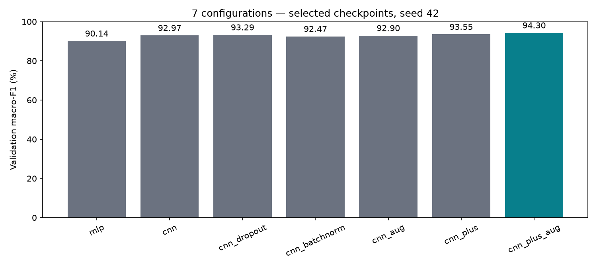
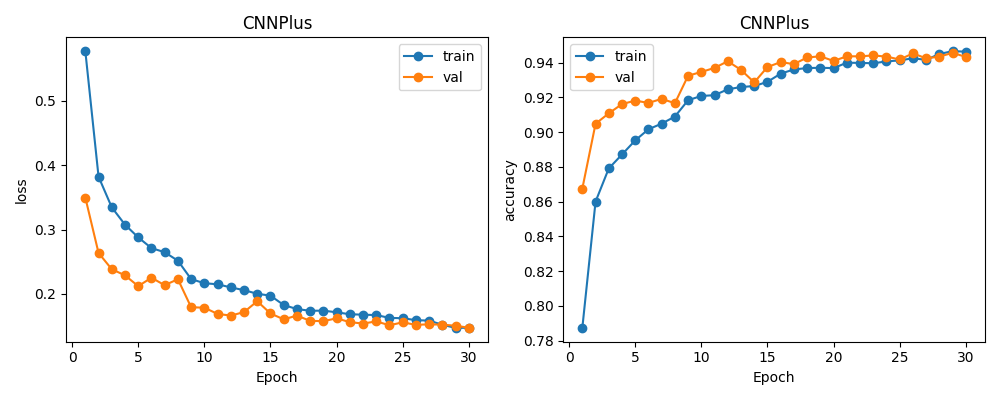
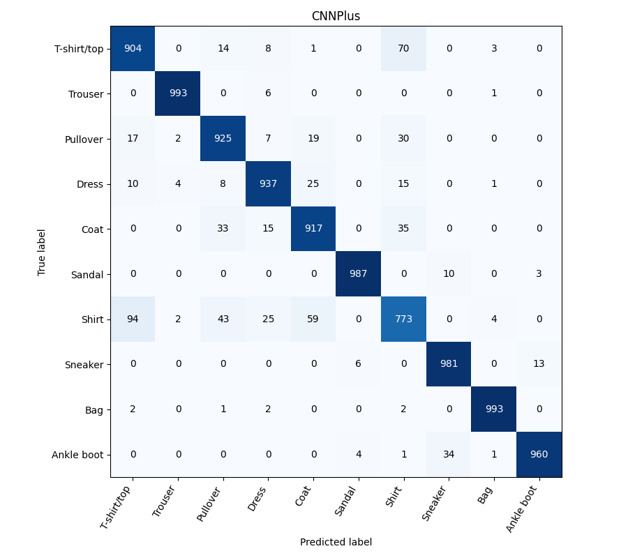
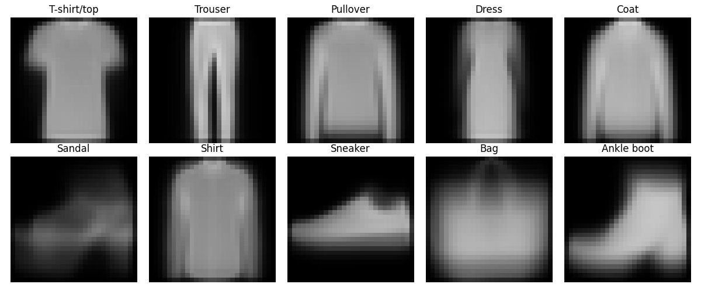
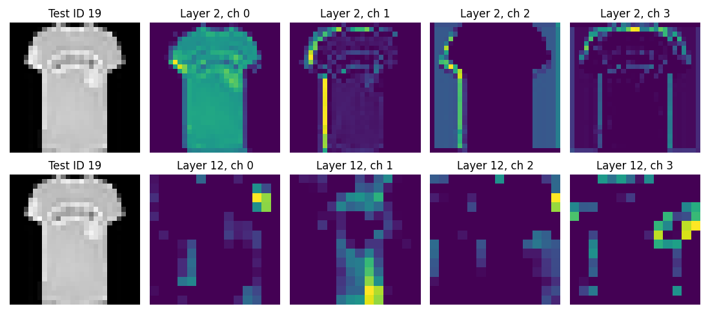
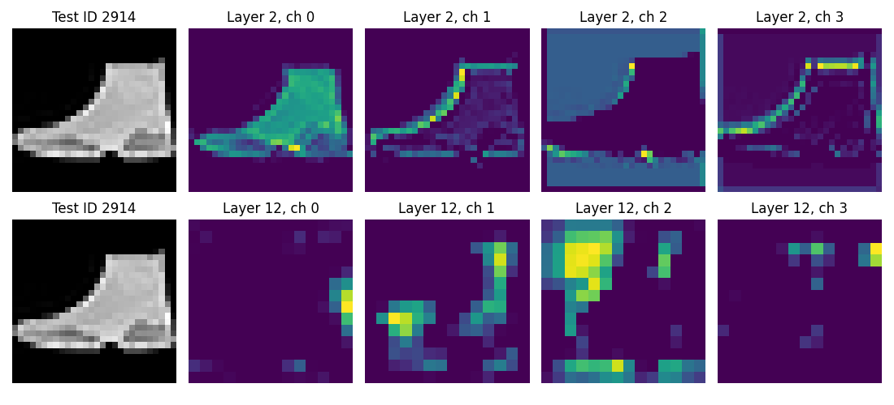

# Đánh giá mô hình để chuẩn bị demo

Ngày 04/11/2026. Run `selection_20261104_144952_e58647`; huấn luyện trên GPU Tesla T4 của Google Colab. Không train trên máy cá nhân.

## Kết luận

Đã có đủ checkpoint và bằng chứng đánh giá để bắt đầu giai đoạn 4 với ảnh Fashion-MNIST. Cấu hình được chọn bằng validation là **cnn_plus_aug**, seed demo **42**. Accuracy test đạt **93.70%**: đúng **9,370/10.000** ảnh, sai **630** ảnh. Chưa có giao diện demo hoàn chỉnh và chưa kiểm chứng ảnh điện thoại.

Accuracy validation tăng từ **91,32%** ở CNN 5 epoch lên **94.33%** ở cấu hình được chọn. Đây là so sánh trên cùng split; test không dùng để chọn cấu hình. Không tuyên bố tối ưu tuyệt đối hoặc chắc chắn được điểm tối đa.

## Các thí nghiệm

54k train / 6k validation / 10k test; split seed 42; Adam 0,001; batch 128; tối đa 30 epoch; early stopping patience 6. Chọn checkpoint theo validation loss, chọn cấu hình theo macro-F1 validation. Chi tiết ở [giao thức](../../../docs/guides/code/giao_thuc_chon_mo_hinh.md).

| Cấu hình | Epoch tốt nhất / đã chạy | Accuracy val | Macro-F1 val | Tham số | Train + val (giây) |
|---|---:|---:|---:|---:|---:|
| mlp | 15/21 | 90.13% | 90.14% | 101,770 | 259.4 |
| cnn | 15/21 | 92.98% | 92.97% | 206,922 | 279.5 |
| cnn_dropout | 16/22 | 93.30% | 93.29% | 206,922 | 293.5 |
| cnn_batchnorm | 7/13 | 92.47% | 92.47% | 207,018 | 173.8 |
| cnn_aug | 24/30 | 92.90% | 92.90% | 206,922 | 559.2 |
| cnn_plus | 8/14 | 93.62% | 93.55% | 468,010 | 201.0 |
| cnn_plus_aug | 30/30 | 94.33% | 94.30% | 468,010 | 588.7 |

Đối chứng Dropout/BN/augmentation chỉ thay một yếu tố trên CNN gốc. CNNPlus thay kiến trúc và kết hợp nhiều kỹ thuật nên không dùng để tách riêng tác động từng kỹ thuật. Mỗi đối chứng ban đầu có một seed; chênh lệch nhỏ chưa đủ chứng minh ý nghĩa thống kê. Thời gian bao gồm train và validation, số epoch thực chạy khác nhau do dừng sớm.

Trong lần chạy này, Dropout riêng tăng macro-F1 validation khoảng **0,31 điểm phần trăm**; BN riêng giảm **0,50**, augmentation riêng giảm **0,07** so với CNN gốc. Augmentation kết hợp CNNPlus tăng **0,75** so với CNNPlus không augmentation. Kỹ thuật bổ sung không mặc nhiên giúp mọi kiến trúc; kết luận chỉ áp dụng cho cấu hình và seed đã thử.

## Test và độ ổn định

| Cấu hình | Seed | Accuracy test | Macro-F1 test |
|---|---:|---:|---:|
| mlp | 42 | 88.55% | 88.55% |
| cnn | 42 | 92.11% | 92.09% |
| cnn_plus_aug | 42 | 93.70% | 93.66% |
| cnn_plus_aug_seed123 | 123 | 93.84% | 93.83% |
| cnn_plus_aug_seed2026 | 2026 | 93.87% | 93.81% |

Cấu hình được chọn qua 3 seed có accuracy test trung bình **93.80%**, độ lệch chuẩn mẫu **0.091 điểm phần trăm**. Macro-F1 trung bình **93.77%**, độ lệch chuẩn **0.091 điểm phần trăm**. Không chọn seed bằng test; bản demo vẫn dùng seed 42. Đây không phải khoảng tin cậy hoặc cross-validation. Test đã được xem ở giai đoạn 2, không phải holdout hoàn toàn chưa biết.

## Kiểm tra khả năng khái quát

Đo lại cùng checkpoint, tắt augmentation/Dropout và bật eval: train-clean accuracy **96.20%**, validation accuracy **94.33%**. Khoảng cách **1.86 điểm phần trăm**. Không dùng train accuracy đo trong lúc trọng số đang thay đổi để khẳng định chắc chắn không overfit.

Checkpoint tốt nhất của bản được chọn nằm ở epoch **30**. Nếu chạm giới hạn 30 epoch thì đó là hết ngân sách, không chứng minh mô hình đã hội tụ hoàn toàn. Không mở thí nghiệm mới chỉ để đuổi theo test đẹp hơn.

Trên đường học, validation loss thấp hơn train loss ở nhiều epoch: train có augmentation, Dropout và trọng số thay đổi trong epoch, còn validation chạy eval trên ảnh gốc. Vì vậy hai đường không đo trong cùng điều kiện. Epoch 29 có accuracy validation cao hơn epoch 30, nhưng epoch 30 có validation loss thấp hơn nên được giữ theo quy tắc đã chốt.

## Các lớp và lỗi dự đoán

| Lớp | Precision | Recall | F1 | Support |
|---|---:|---:|---:|---:|
| T-shirt/top | 88.02% | 90.40% | 89.20% | 1000 |
| Trouser | 99.20% | 99.30% | 99.25% | 1000 |
| Pullover | 90.33% | 92.50% | 91.40% | 1000 |
| Dress | 93.70% | 93.70% | 93.70% | 1000 |
| Coat | 89.81% | 91.70% | 90.75% | 1000 |
| Sandal | 99.00% | 98.70% | 98.85% | 1000 |
| Shirt | 83.48% | 77.30% | 80.27% | 1000 |
| Sneaker | 95.71% | 98.10% | 96.89% | 1000 |
| Bag | 99.00% | 99.30% | 99.15% | 1000 |
| Ankle boot | 98.36% | 96.00% | 97.17% | 1000 |

[Các cặp nhầm có hướng](top_confusions.csv) dùng `nhãn thật → nhãn dự đoán`. Không cộng hai chiều rồi trình bày như một chiều. [Ảnh sai tự tin cao](confident_errors.png) được lấy theo quy tắc cố định từ chính predictions của checkpoint này; điểm softmax cao vẫn có thể sai.

**Shirt là lớp yếu nhất:** đúng 773/1.000 ảnh, recall 77,30%, F1 80,27%. Trong 227 ảnh Shirt sai, 94 bị đoán thành T-shirt/top, 59 thành Coat và 43 thành Pullover. Chiều T-shirt/top → Shirt có 70 ảnh. Tổng đường chéo ma trận là 9.370; tổng ma trận là 10.000, khớp accuracy 93,70%.

## Đặc trưng và giới hạn giải thích

Ảnh trung bình tính từ train cho thấy hình dáng tổng quát của lớp; đây là thống kê mô tả, không phải kỹ thuật học đặc trưng mới. ToTensor/Normalize là tiền xử lý. Các file `features_<sample_id>.png` thể hiện kích hoạt sau ReLU đầu và cuối của CNN trên cùng ảnh; [metadata](feature_metadata.json) ghi sample ID, tầng, kênh và hash checkpoint.

Ảnh trung bình cho thấy Trouser có hai dải dọc tách nhau, Bag có thân rộng, còn Shirt/Pullover/Coat cùng có thân áo và tay dài khá giống nhau. Đây là một giả thuyết hình thái phù hợp với các cặp nhầm, chưa chứng minh nguyên nhân của từng lỗi. Ảnh trung bình còn làm mờ chi tiết cổ áo, nút và họa tiết vốn có thể giúp phân biệt các lớp.

Ở ảnh **test ID 19**, tầng `features.2` giữ kích thước 28×28: kênh 0 phản ứng trên phần thân, các kênh 1–3 làm nổi các vùng biên khác nhau. Ở `features.12`, kích thước còn 14×14 sau pooling trước đó; kích hoạt thành các cụm khác nhau thay vì giữ nguyên hình dáng ảnh. Mạng học các bộ lọc từ loss, khác với việc người lập trình tự thiết kế đặc trưng. Nhiều tầng phối hợp thông tin trong vùng ảnh rộng hơn; không thể suy ra tên gọi ngữ nghĩa của mỗi kênh chỉ từ hình này.

Ở **test ID 2914**, nhãn gốc là Sneaker nhưng mô hình đoán Ankle boot, điểm softmax khoảng **99,9954%** (hình làm tròn thành 100,0%). Tầng đầu vẫn thể hiện đường biên và phần đế; tầng sâu vẫn có kích hoạt rõ dù đáp án sai. Hình dạng cổ giày cao gợi ý sự tương đồng giữa hai lớp, nhưng không đủ để kết luận nhãn gốc sai hoặc một bộ lọc cụ thể gây lỗi. Demo cần giữ ví dụ này để giải thích rằng điểm cao không bảo đảm đúng.

Các kênh dùng thang màu riêng; không so độ sáng tuyệt đối giữa hai kênh. Hiện minh họa 4 kênh/tầng trên 6 ảnh, chưa phải khảo sát mọi kênh và mọi mẫu. Không gán nhãn “bộ lọc cổ áo” hoặc xem feature map là lời giải thích nhân quả khi chưa có kiểm chứng. Không dùng các ảnh test sai này để chỉnh lại mô hình trong cùng đánh giá.

## Kiến trúc và đường đi của ảnh

Với batch một ảnh: `1×1×28×28 → Conv/BN/ReLU ×2 → 1×32×28×28 → MaxPool → 1×32×14×14 → Conv/BN/ReLU ×2 → 1×64×14×14 → MaxPool → 1×64×7×7 → Flatten 3.136 → Linear 128 → ReLU/Dropout → Linear 10 logits`.

Conv học mẫu cục bộ và dùng cùng bộ lọc ở nhiều vị trí; pooling giảm kích thước; BN chuẩn hóa kích hoạt; Dropout chỉ bỏ ngẫu nhiên một phần kích hoạt lúc train. Flatten đổi cách sắp xếp, không xóa giá trị. Tổng **468.010 tham số** được đối chiếu với [shape và tham số từng lớp](architecture.json). Cross-Entropy nhận logits và nhãn thật; gradient cho biết loss thay đổi theo trọng số, Adam dùng gradient để cập nhật trọng số. Khi demo dùng eval/inference mode và không cập nhật trọng số.

## Sẵn sàng demo đến đâu?

- Có checkpoint, nhãn, thống kê chuẩn hóa, source và metadata trong `experiments/runs/selection_20261104_144952_e58647/demo_bundle`.
- Kiểm chứng nạp lại checkpoint và inference từng ảnh khớp dự đoán đánh giá; số liệu bảng/ma trận/predictions nhất quán. Cả 9 lần chạy dùng cùng split, khớp mốc lịch sử.
- ZIP đã tải, SHA256 khớp Colab, CRC PASS; giải nén 172 tệp. Inference CPU trên 6 ảnh (4 đúng, 2 sai) khớp xác suất Colab trong dung sai; đã tính lại accuracy/macro-F1 và kiểm tra ma trận/support/hash cho cả 5 bảng test. Xem [kiểm chứng local](local_verification.json). Không train trên máy cá nhân.
- Mô hình có **468,010 tham số**. Forward batch 1 trên **cuda**: trung vị **0.576 ms**, P95 **0.666 ms**; 10 lượt làm nóng, 100 lượt đo. Chưa tính đọc ảnh, tiền xử lý, giao diện hoặc truyền mạng.
- `demo/predict.py` là đường inference cơ bản. Giai đoạn 4 tiếp theo: giao diện chọn ảnh, top-3, so sánh MLP/CNN, ảnh đúng/sai và đặc trưng. Giai đoạn 5 mới hoàn thiện báo cáo/slide/bàn giao.
- Ảnh chụp thật khác phân phối Fashion-MNIST; không cam kết mô hình phân loại tốt mọi ảnh thời trang.

## Đối chiếu yêu cầu

| Mục | Bằng chứng hiện có | Còn lại |
|---|---|---|
| R01 — Bài toán | 10 lớp, ảnh xám 28×28, giới hạn dữ liệu rõ | Đưa vào báo cáo nộp |
| R02 — Dữ liệu | Hash dữ liệu, split khớp, thống kê train, ảnh trung bình | Chọn hình trước/sau augmentation cho báo cáo |
| R03 — Đặc trưng | Phân tích hình dáng, 6 ảnh/2 tầng, liên hệ lỗi và giới hạn | Nhóm đọc và diễn giải khi bảo vệ; có thể mở rộng số kênh |
| R04 — CNN tự xây | Shape, tham số, đường đi ảnh | Vẽ sơ đồ vào slide |
| R05 — MLP đối chứng | Cùng split, quy tắc chọn checkpoint, ngân sách tối đa và tập đánh giá | Đưa bảng so sánh vào báo cáo nộp |
| R06 — Hiểu train | Mã engine, lý thuyết và kiểm chứng optimizer/scheduler/dừng sớm | Thành viên thực hành giải thích; không thể xác nhận mức hiểu bằng việc có mã |
| R07 — Cải tiến | Đối chứng Dropout/BN/augmentation, kết hợp CNNPlus, 3 seed cấu hình chọn | Nêu giới hạn ablation một seed |
| R08 — Trực quan/demo | Hình lỗi, feature maps, CLI inference đã chạy | Giao diện demo và bài trình bày chưa hoàn thành |

## Bằng chứng và nguồn

[Notebook Colab](https://colab.research.google.com/drive/1K9FNgM9mzUL55AmOaVcc_vIfLd5DKkP0); [cấu hình/giao thức](protocol.json); [môi trường](environment.json); [kiểm chứng](checks.json); [nguồn số liệu](source_results.json). Các số liệu của nhóm trước chỉ dùng rà soát cách trình bày, không dùng làm kết quả thực nghiệm của nhóm này.
